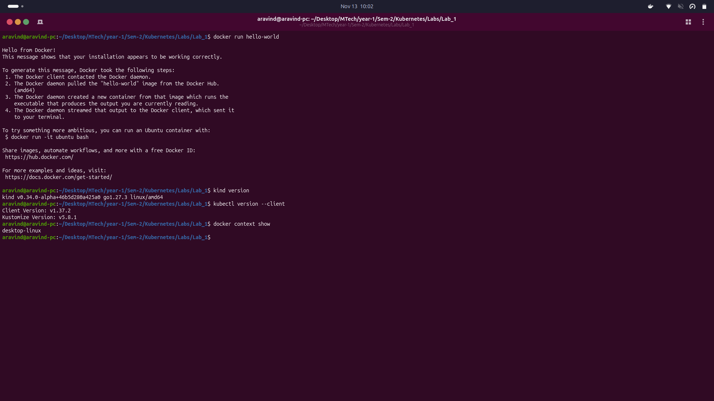
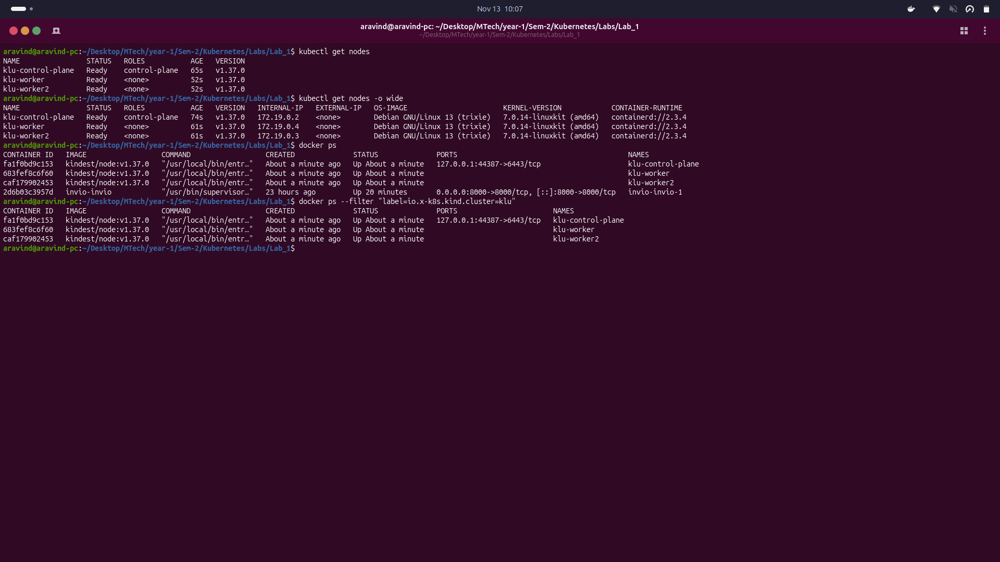
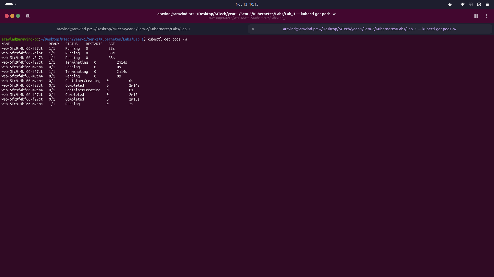
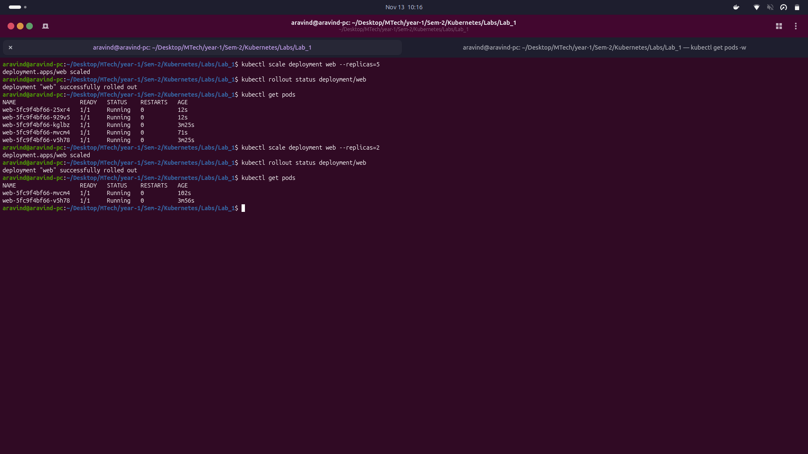
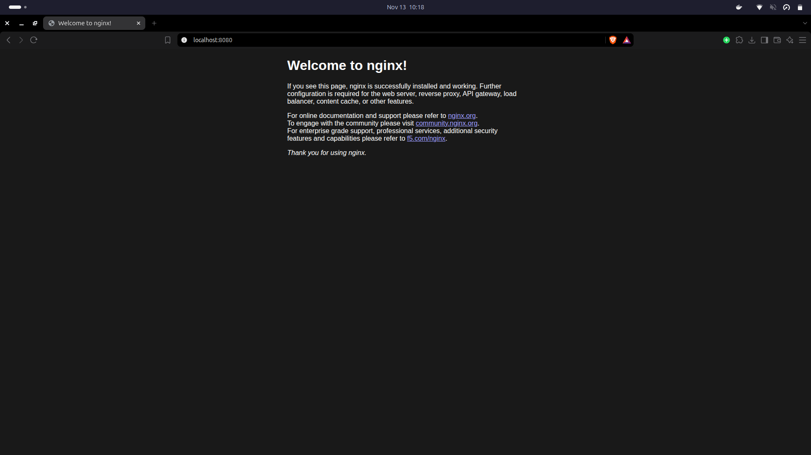
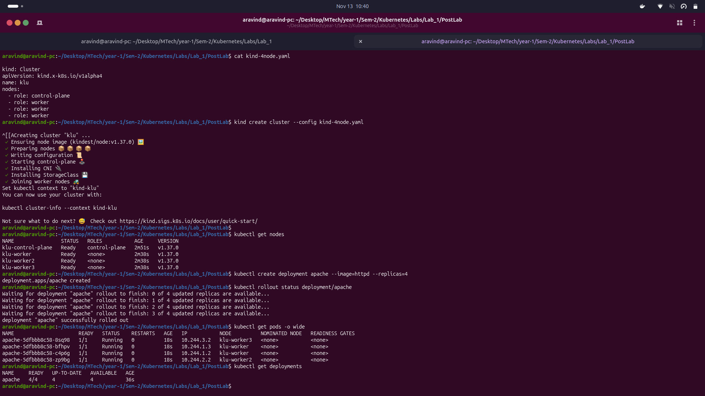
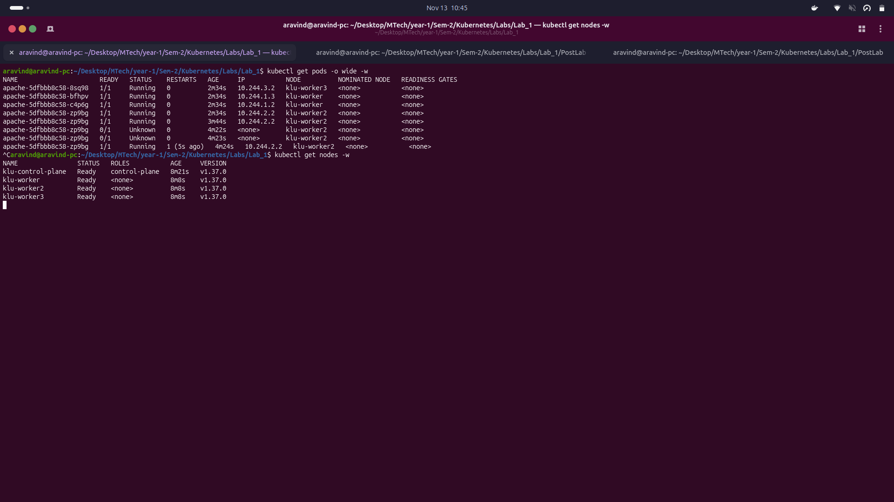
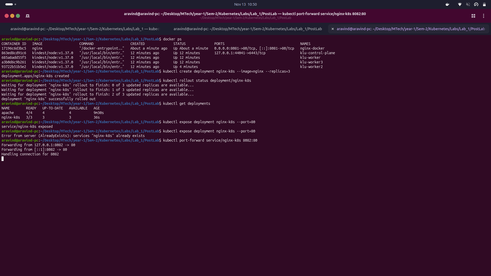
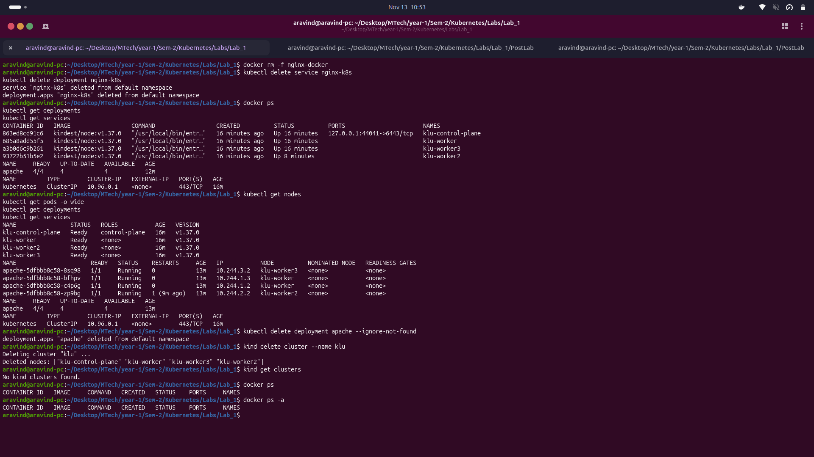

# Lab 1: Multi-Node Kubernetes Cluster Setup and Workload Management

## InLab

### Question 1: Create a 3-node Kubernetes cluster with kind and identify the control-plane components.

#### Step 1: Setup Verification
- **Why and what we are doing:** Verify that Docker Engine is running, kind CLI is available, and kubectl client is operational.
```powershell
docker run hello-world
kind version
kubectl version --client
```


#### Step 2: Create Cluster Configuration
- **Why and what we are doing:** Create a Kind multi-node cluster manifest (`kind-3node.yaml`) defining 1 control-plane node and 2 worker nodes.
```powershell
mkdir $HOME\k8s-lab1
cd $HOME\k8s-lab1
notepad kind-3node.yaml
```
*File content:*
```yaml
kind: Cluster
apiVersion: kind.x-k8s.io/v1alpha4
name: klu
nodes:
- role: control-plane
- role: worker
- role: worker
```
.png)

#### Step 3: Cluster Creation
- **Why and what we are doing:** Provision the multi-node Kubernetes cluster using kind.
```powershell
kind create cluster --config kind-3node.yaml
```


#### Step 4: Verify Nodes and Docker Containers
- **Why and what we are doing:** Verify that all three nodes are `Ready` in Kubernetes and inspect the underlying Docker containers running each node.
```powershell
kubectl get nodes
docker ps
```


#### Step 5: Identify Control-Plane Pods
- **Why and what we are doing:** List the control-plane pods running in the `kube-system` namespace (etcd, kube-apiserver, kube-controller-manager, kube-scheduler).
```powershell
kubectl get pods -n kube-system
```


---

### Question 2: Deploy nginx with three replicas, observe self-healing, scale the Deployment and open the application in a browser.

#### Step 1: Deploy nginx with 3 Replicas
- **Why and what we are doing:** Create an nginx Deployment with 3 replicas and inspect the node scheduling distribution.
```powershell
kubectl create deployment web --image=nginx --replicas=3
kubectl get pods -o wide
```


#### Step 2: Observe Self-Healing
- **Why and what we are doing:** Watch pods in real-time, delete an active pod, and observe the ReplicaSet controller automatically recreating a replacement pod.
```powershell
# Window 1 (watch)
kubectl get pods -w

# Window 2 (delete)
kubectl delete pod <pod-name>
```


#### Step 3: Scale the Deployment
- **Why and what we are doing:** Scale the Deployment up to 5 replicas and subsequently down to 2 replicas, verifying active pod counts.
```powershell
kubectl scale deployment web --replicas=5
kubectl get pods
kubectl scale deployment web --replicas=2
kubectl get pods
```


#### Step 4: Expose Service and Access in Browser
- **Why and what we are doing:** Expose the deployment as a ClusterIP Service and use port-forwarding to access the nginx web server from the host browser.
```powershell
kubectl expose deployment web --port=80
kubectl port-forward service/web 8080:80
```

.png)

#### Step 5: Clean Up
- **Why and what we are doing:** Delete the deployment and service to clean up cluster resources.
```powershell
kubectl delete service web
kubectl delete deployment web
```


---

## PostLab

### Question 1: Deploy httpd with 4 replicas on a 4-node cluster.
- **Why and what we are doing:** Create a 4-node Kind cluster (1 control-plane, 3 workers) using `kind-4node.yaml` and deploy an Apache HTTP Server (`httpd`) workload with 4 replicas.
```powershell
kind create cluster --config kind-4node.yaml
kubectl create deployment httpd-app --image=httpd --replicas=4
kubectl get pods -o wide
```


---

### Question 2: Simulate worker node failure and observe pod behavior and recovery.

#### Sub Question 2A: Worker Node Failure
- **Why and what we are doing:** Simulate hardware or VM failure by stopping a worker node Docker container and observing node status change to `NotReady`.
```powershell
docker stop klu-worker
kubectl get nodes
```


#### Sub Question 2B: Pod Status Behavior
- **Why and what we are doing:** Monitor pod eviction and rescheduling behavior when a worker node becomes unresponsive.
```powershell
kubectl get pods -o wide -w
```


#### Sub Question 2C: Worker Node Recovery
- **Why and what we are doing:** Restart the worker node container and verify that the node returns to `Ready` status and recovers.
```powershell
docker start klu-worker
kubectl get nodes
kubectl get pods -o wide
```


---

### Question 3: Comparative analysis between standalone Docker container and Kubernetes Deployment.

#### Sub Question 3A: Standalone Docker Container
- **Why and what we are doing:** Run a standalone nginx container directly on Docker engine and access via browser.
```powershell
docker run -d --name standalone-nginx -p 8081:80 nginx
```


#### Sub Question 3B: Kubernetes Deployment
- **Why and what we are doing:** Run nginx inside Kubernetes, expose via service and port-forwarding, observing container orchestration benefits (self-healing, scaling, abstracted networking).
```powershell
kubectl create deployment k8s-nginx --image=nginx --replicas=2
kubectl expose deployment k8s-nginx --port=80
kubectl port-forward service/k8s-nginx 8082:80
```



---

### Question 4: Cluster Clean Up
- **Why and what we are doing:** Tear down the 4-node kind cluster and remove all temporary containers.
```powershell
kind delete cluster --name klu
```

