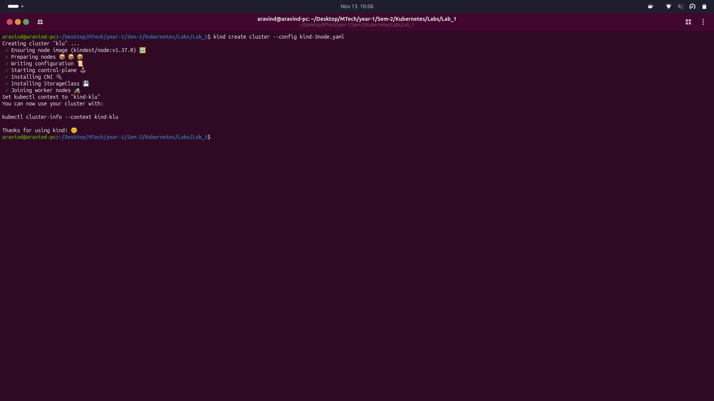
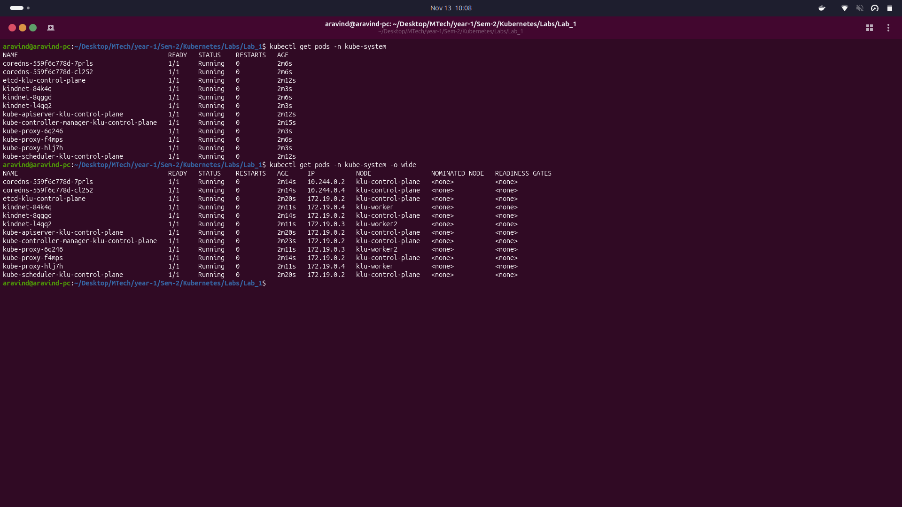
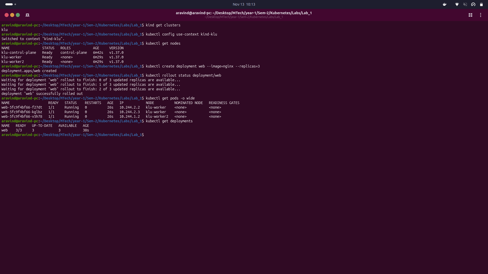
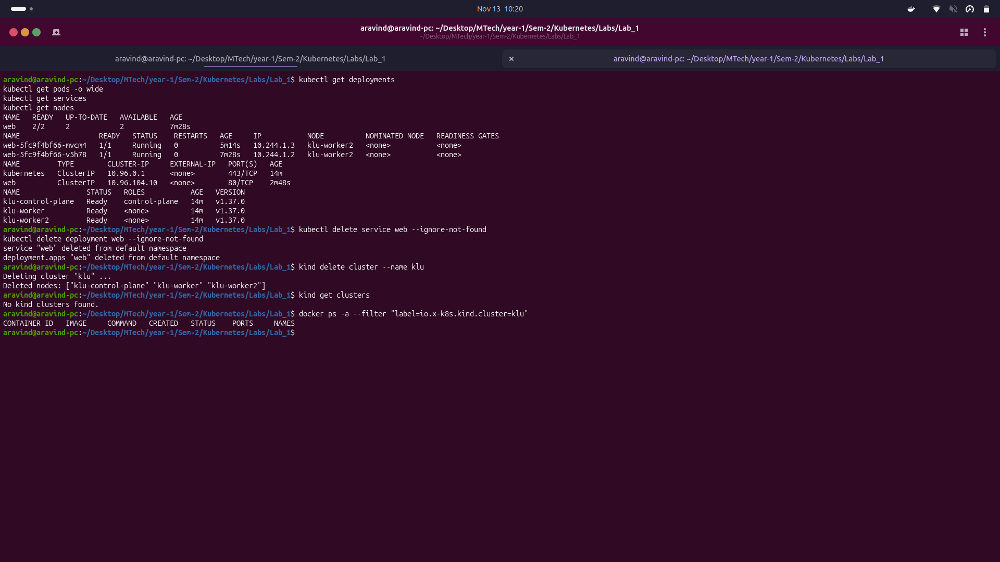
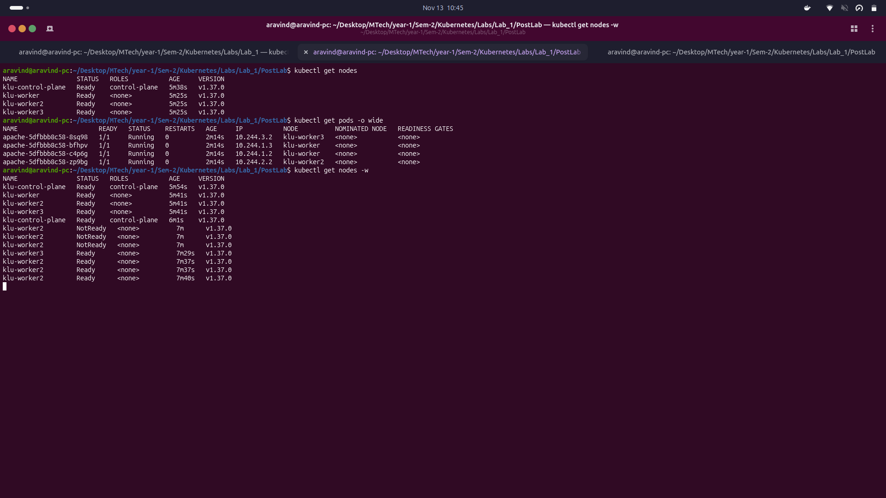
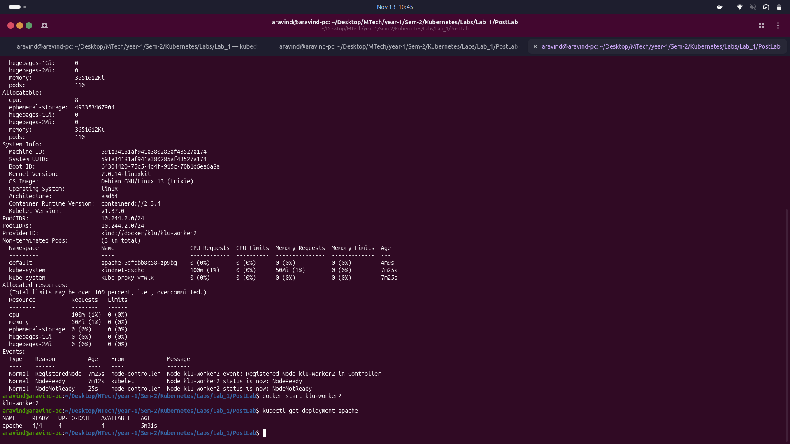
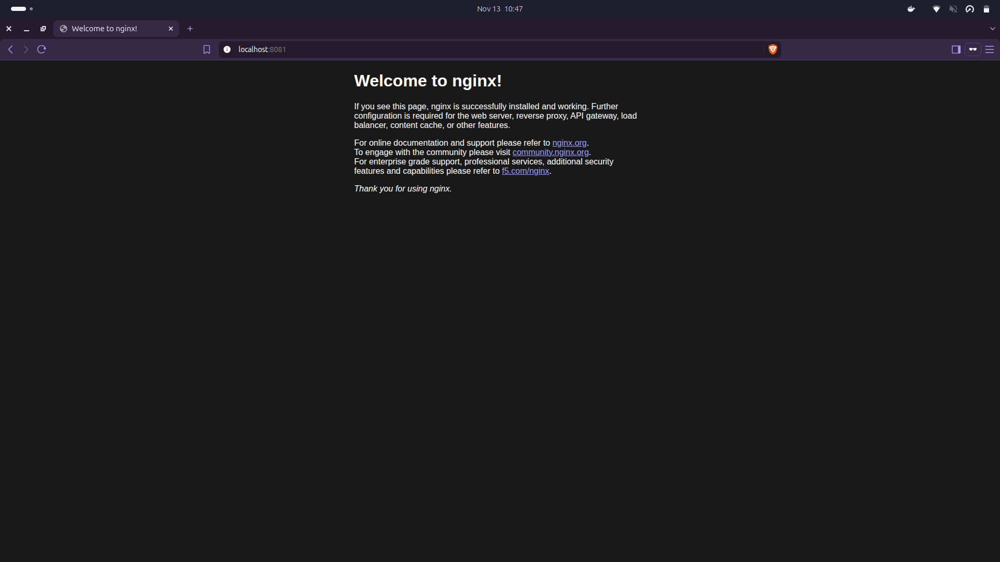

# Lab 1: Multi-Node Kubernetes Cluster Setup and Workload Management

## InLab

### Question 1: Create a 3-node Kubernetes cluster with kind and identify the control-plane components.

#### Step 1: Setup Verification
- **Why and what we are doing:** Before creating anything, I checked that Docker was actually running and that `kind` and `kubectl` answered from my terminal.
```powershell
docker run hello-world
kind version
kubectl version --client
```


#### Step 2: Create Cluster Configuration
- **Why and what we are doing:** I wanted 1 control-plane node and 2 workers so I could actually see workloads spread across machines, so I wrote `kind-3node.yaml`. I named the cluster `klu` after my university, though you can name yours anything you like (like `my-lab` or `dev`)—just remember `kind` prefixes your `kubectl` context with `kind-`.
```powershell
mkdir $HOME\k8s-lab1
cd $HOME\k8s-lab1
notepad kind-3node.yaml
```
*File content:*
```yaml
kind: Cluster
apiVersion: kind.x-k8s.io/v1alpha4
name: klu
nodes:
- role: control-plane
- role: worker
- role: worker
```
.png)

#### Step 3: Cluster Creation
- **Why and what we are doing:** Then I handed that config file to `kind` and waited about a minute while it spun up the nodes and switched my `kubectl` context to `kind-klu`.
```powershell
kind create cluster --config kind-3node.yaml
```


#### Step 4: Verify Nodes and Docker Containers
- **Why and what we are doing:** Once the cluster came up, I ran `kubectl get nodes` alongside `docker ps`—seeing that each Kubernetes "node" is literally just a Docker container running on my laptop made the whole setup click.
```powershell
kubectl get nodes
docker ps
```


#### Step 5: Identify Control-Plane Pods
- **Why and what we are doing:** Next, I peeked inside `kube-system` to find the brains of the cluster: `etcd`, `kube-apiserver`, `kube-controller-manager`, and `kube-scheduler` all running as Pods.
```powershell
kubectl get pods -n kube-system
```


---

### Question 2: Deploy nginx with three replicas, observe self-healing, scale the Deployment and open the application in a browser.

#### Step 1: Deploy nginx with 3 Replicas
- **Why and what we are doing:** I launched an `nginx` Deployment with 3 replicas and used `-o wide` so I could see which worker node each Pod landed on.
```powershell
kubectl create deployment web --image=nginx --replicas=3
kubectl get pods -o wide
```


#### Step 2: Observe Self-Healing
- **Why and what we are doing:** I wanted to see self-healing for myself, so I left `kubectl get pods -w` watching in one terminal and deleted a Pod from another—within seconds, the ReplicaSet spun up a fresh replacement to keep the count at 3.
```powershell
kubectl get pods -w

kubectl delete pod <pod-name>
```


#### Step 3: Scale the Deployment
- **Why and what we are doing:** Next, I scaled `web` up to 5 replicas and then back down to 2, watching Kubernetes create and terminate Pods to match whatever number I asked for.
```powershell
kubectl scale deployment web --replicas=5
kubectl get pods
kubectl scale deployment web --replicas=2
kubectl get pods
```


#### Step 4: Expose Service and Access in Browser
- **Why and what we are doing:** To actually reach nginx from my browser, I exposed the Deployment as a Service and forwarded local port `8080` to port `80`.
```powershell
kubectl expose deployment web --port=80
kubectl port-forward service/web 8080:80
```

.png)

#### Step 5: Clean Up
- **Why and what we are doing:** Once I verified the welcome page in the browser, I deleted the Service and Deployment to leave the cluster clean.
```powershell
kubectl delete service web
kubectl delete deployment web
```


---

## PostLab

### Question 1: Deploy httpd with 4 replicas on a 4-node cluster.
- **Why and what we are doing:** For the post-lab, I bumped the cluster up to 4 nodes (`kind-4node.yaml`: 1 control-plane, 3 workers) and deployed 4 replicas of Apache (`httpd`) to see how they spread out.
```powershell
kind create cluster --config kind-4node.yaml
kubectl create deployment httpd-app --image=httpd --replicas=4
kubectl get pods -o wide
```


---

### Question 2: Simulate worker node failure and observe pod behavior and recovery.

#### Sub Question 2A: Worker Node Failure
- **Why and what we are doing:** To simulate a machine crashing mid-flight, I stopped the `klu-worker` container with `docker stop` and watched it turn `NotReady` in `kubectl get nodes`.
```powershell
docker stop klu-worker
kubectl get nodes
```


#### Sub Question 2B: Pod Status Behavior
- **Why and what we are doing:** I kept `kubectl get pods -o wide -w` running to see how long Kubernetes waits before evicting the Pods from the dead node and rescheduling them onto healthy workers.
```powershell
kubectl get pods -o wide -w
```


#### Sub Question 2C: Worker Node Recovery
- **Why and what we are doing:** Then I brought the node back with `docker start klu-worker` and checked that it rejoined as `Ready`.
```powershell
docker start klu-worker
kubectl get nodes
kubectl get pods -o wide
```


---

### Question 3: Comparative analysis between standalone Docker container and Kubernetes Deployment.

#### Sub Question 3A: Standalone Docker Container
- **Why and what we are doing:** First, I ran a plain `nginx` container directly with `docker run`—it works fast, but if it crashes, nothing brings it back.
```powershell
docker run -d --name standalone-nginx -p 8081:80 nginx
```



#### Sub Question 3B: Kubernetes Deployment
- **Why and what we are doing:** Comparing that with a 2-replica Kubernetes Deployment exposed via a Service showed the real difference: Kubernetes gives you self-healing, easy scaling, and load-balanced networking out of the box.
```powershell
kubectl create deployment k8s-nginx --image=nginx --replicas=2
kubectl expose deployment k8s-nginx --port=80
kubectl port-forward service/k8s-nginx 8082:80
```


---

### Question 4: Cluster Clean Up
- **Why and what we are doing:** Finally, I tore down the 4-node kind cluster so it wouldn't eat up background resources.
```powershell
kind delete cluster --name klu
```

