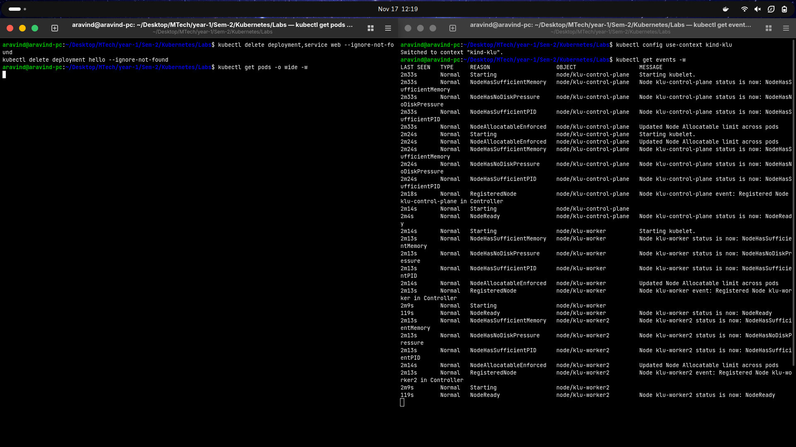
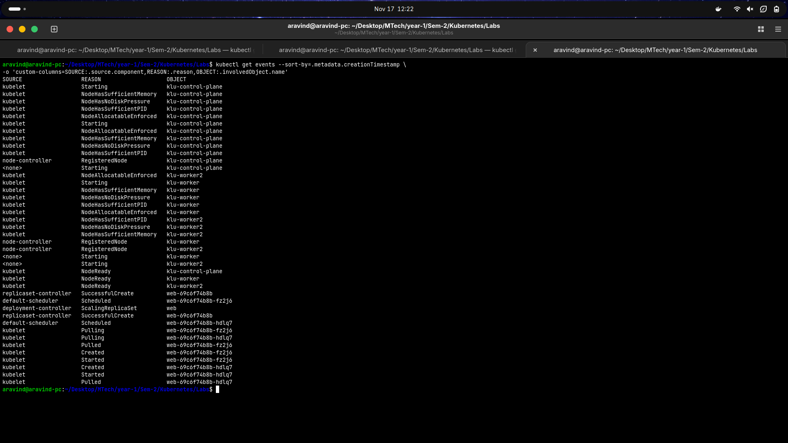
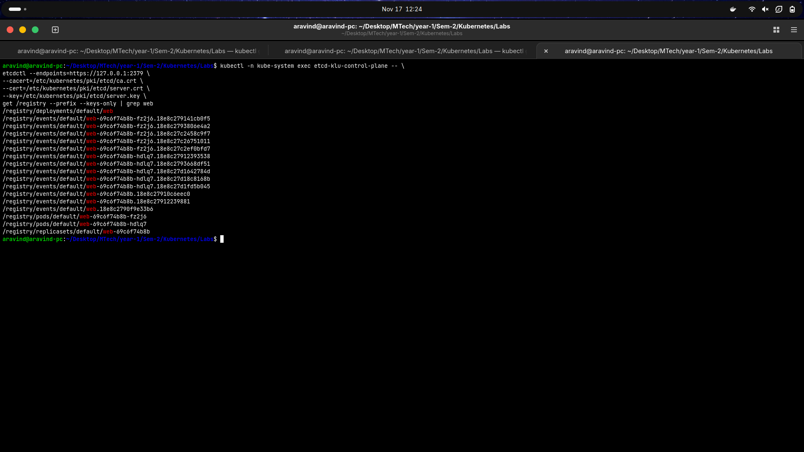
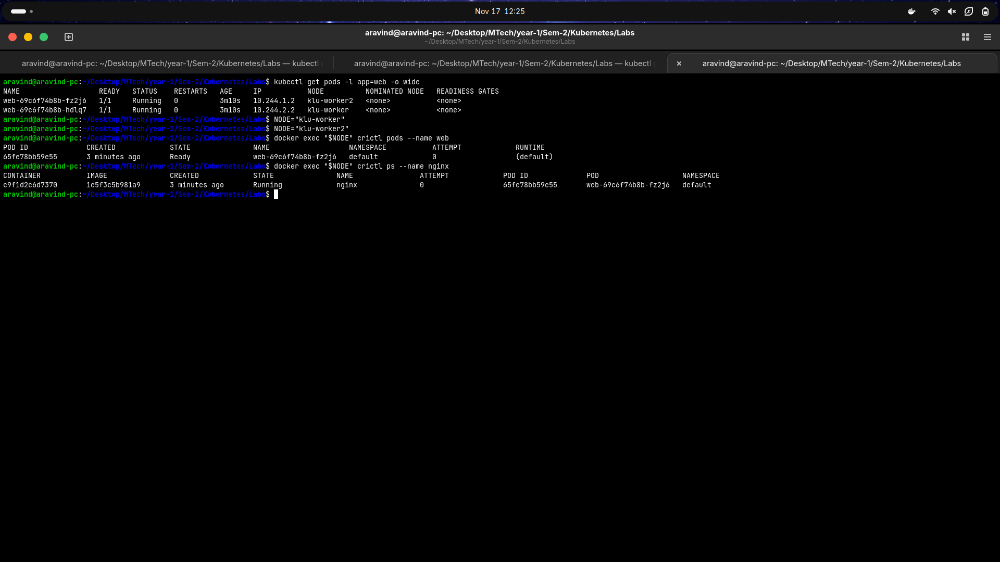
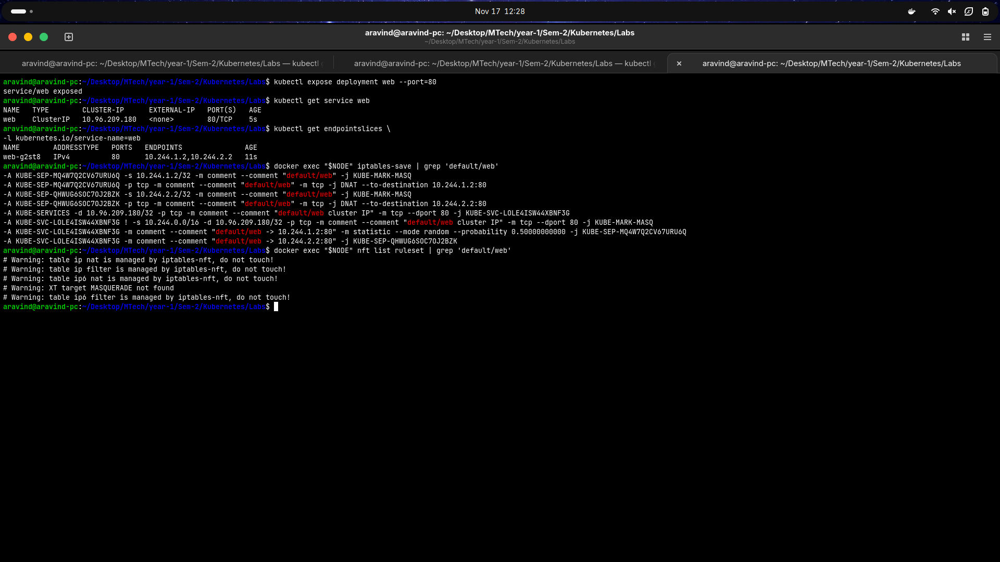
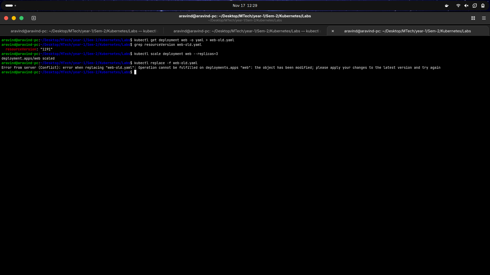

# Lab 2: Trace `kubectl create deployment` End to End

## InLab

### Question 1: Follow one Deployment from the kubectl command to running containers, and collect evidence of the component that acts at each step.

#### Step 0: Prepare Cluster and Watch Streams
- **Why and what we are doing:** Verify cluster nodes are Ready, clean up any existing objects from previous labs, and launch real-time event and pod watchers.
```powershell
kubectl config use-context kind-klu
kubectl get nodes
kubectl delete deployment,service web --ignore-not-found
kubectl delete deployment hello --ignore-not-found

# Watch streams (Window 1 and Window 2)
kubectl get events -w
kubectl get pods -o wide -w
```


#### Step 1: Trace 1 – HTTP Request Sent by kubectl to API Server
- **Why and what we are doing:** Use verbose logging (`-v=6`) to observe the HTTP `POST` request sent to `kube-apiserver` and verify the `201 Created` response.
```powershell
kubectl create deployment web --image=nginx:1.27 --replicas=2 -v=6 2>&1 | Select-String "deployments"
```


#### Step 2: Trace 2 – Events and Their Source Components
- **Why and what we are doing:** List cluster events in chronological order to observe component handoffs (`deployment-controller` → `replicaset-controller` → `default-scheduler` → `kubelet`).
```powershell
kubectl get events --sort-by=.metadata.creationTimestamp -o "custom-columns=SOURCE:.source.component,REASON:.reason,OBJECT:.involvedObject.name"
```


#### Step 3: Trace 3 – Ownership Chain and Field Attribution
- **Why and what we are doing:** Trace parent-child ownership (`Deployment` → `ReplicaSet` → `Pod`) via `ownerReferences`, and verify field assignments (`spec.nodeName` written by scheduler, `status.podIP` written by kubelet).
```powershell
kubectl get rs -l app=web -o "custom-columns=RS:.metadata.name,OWNER:.metadata.ownerReferences[0].name"
kubectl get pods -l app=web -o "custom-columns=POD:.metadata.name,OWNER:.metadata.ownerReferences[0].name,NODE:.spec.nodeName,IP:.status.podIP"
```


#### Step 4: Trace 4 – Look Inside etcd
- **Why and what we are doing:** Execute `etcdctl` inside the control plane etcd container using TLS certs to verify keys are stored under `/registry/<type>/<namespace>/<name>`.
```powershell
kubectl -n kube-system exec etcd-klu-control-plane -- etcdctl --endpoints=https://127.0.0.1:2379 --cacert=/etc/kubernetes/pki/etcd/ca.crt --cert=/etc/kubernetes/pki/etcd/server.crt --key=/etc/kubernetes/pki/etcd/server.key get /registry --prefix --keys-only | Select-String "web"
```


#### Step 5: Trace 5 – Pod Sandbox and Container on Node (`crictl`)
- **Why and what we are doing:** Inspect the container runtime directly on the worker node using `crictl` to observe the Pod Sandbox and the running `nginx` container.
```powershell
$NODE = "klu-worker"
docker exec $NODE crictl pods --name web
docker exec $NODE crictl ps --name nginx
```


#### Step 6: Trace 6 – Pod IP and Kubelet Logs
- **Why and what we are doing:** Inspect the Pod Sandbox to verify its IP matches `status.podIP`, and check `journalctl` for Kubelet's `SyncLoop ADD` event.
```powershell
docker exec $NODE crictl inspectp <POD-ID> | Select-String '"ip"'
docker exec $NODE journalctl -u kubelet --no-pager | Select-String "web-" | Select-Object -Last 5
```


#### Step 7: Trace 7 – Service, Endpoints, and kube-proxy Rules
- **Why and what we are doing:** Expose the Deployment as a Service, verify `EndpointSlice` controller maps Pod IPs, and observe `kube-proxy` iptables packet filtering rules.
```powershell
kubectl expose deployment web --port=80
kubectl get service web
kubectl get endpointslices -l kubernetes.io/service-name=web
docker exec $NODE iptables-save | Select-String "default/web"
```


#### Step 8: Trace 8 – Make API Server Return 409 Conflict (Optimistic Concurrency Control)
- **Why and what we are doing:** Save deployment YAML (`web-old.yaml`), scale the deployment in the cluster (incrementing `resourceVersion`), and attempt to replace with the stale manifest to observe API server conflict rejection.
```powershell
cmd /c "kubectl get deployment web -o yaml > web-old.yaml"
Select-String "resourceVersion" web-old.yaml
kubectl scale deployment web --replicas=3
kubectl replace -f web-old.yaml
```


#### Step 9: Clean Up
- **Why and what we are doing:** Delete the deployment and service to return the cluster to a clean state.
```powershell
kubectl delete service web
kubectl delete deployment web
```


---

## PostLab

### Question 1: Concurrency Conflict Manifest Verification
- **Why and what we are doing:** Verify the preserved YAML manifest used during optimistic concurrency testing.
```powershell
Get-Content PostLab\web-old.yaml | Select-String "resourceVersion"
```
*(Preserved in `PostLab/web-old.yaml`; screenshot directory tracked via `ScreenShots/PostLab/.gitkeep`)*
