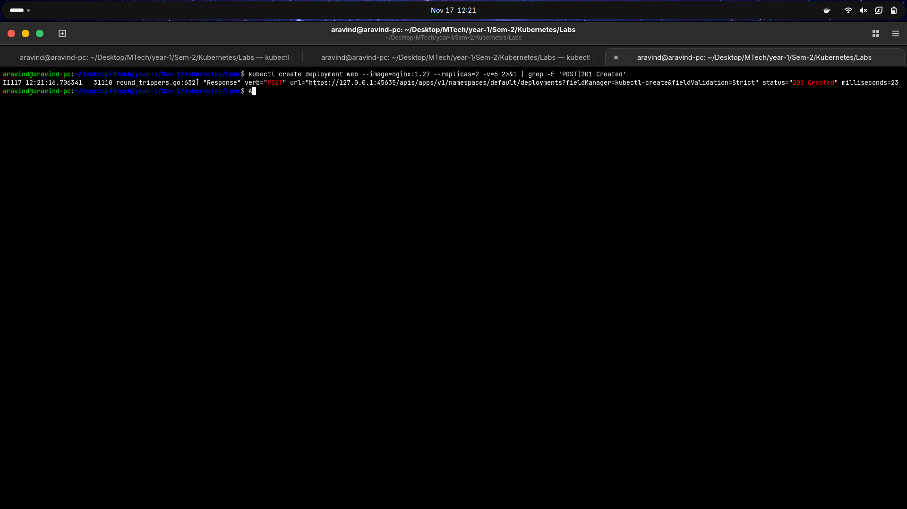
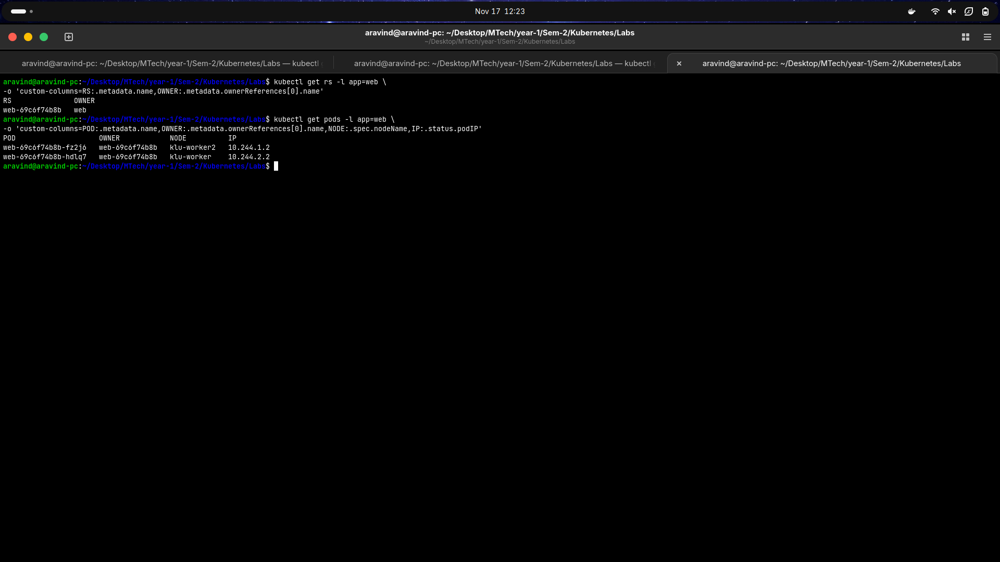
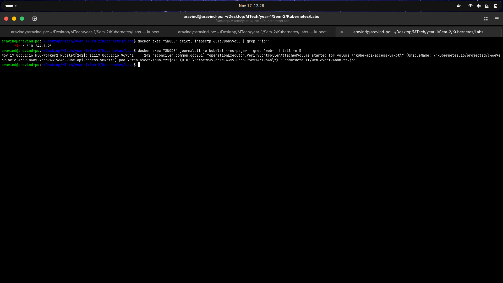
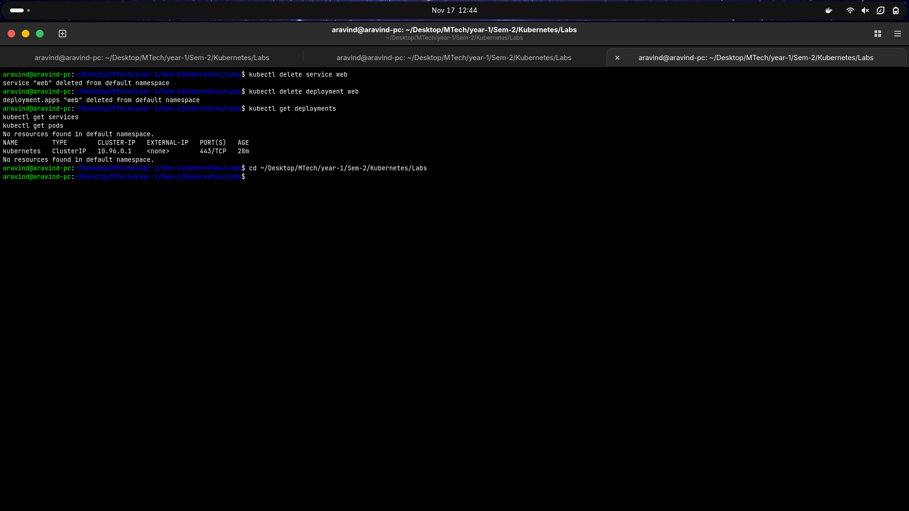

# Lab 2: Trace `kubectl create deployment` End to End

## InLab

### Question 1: Follow one Deployment from the kubectl command to running containers, and collect evidence of the component that acts at each step.

#### Step 0: Prepare Cluster and Watch Streams
- **Why and what we are doing:** Before tracing a Deployment from scratch, I cleaned out leftover objects from Lab 1 and opened two watch windows (`events -w` and `pods -o wide -w`) so I could see every component react in real time.
```powershell
kubectl config use-context kind-klu
kubectl get nodes
kubectl delete deployment,service web --ignore-not-found
kubectl delete deployment hello --ignore-not-found

kubectl get events -w
kubectl get pods -o wide -w
```


#### Step 1: Trace 1 – HTTP Request Sent by kubectl to API Server
- **Why and what we are doing:** Passing `-v=6` to `kubectl` revealed that `kubectl` is really just an HTTP client—it sent a `POST` to `/apis/apps/v1/namespaces/default/deployments` and got back `201 Created`.
```powershell
kubectl create deployment web --image=nginx:1.27 --replicas=2 -v=6 2>&1 | Select-String "deployments"
```


#### Step 2: Trace 2 – Events and Their Source Components
- **Why and what we are doing:** Sorting cluster events by timestamp showed the exact relay race: `deployment-controller` → `replicaset-controller` → `default-scheduler` → `kubelet`.
```powershell
kubectl get events --sort-by=.metadata.creationTimestamp -o "custom-columns=SOURCE:.source.component,REASON:.reason,OBJECT:.involvedObject.name"
```
*Command breakdown:*
- `--sort-by=.metadata.creationTimestamp` — sort events in the order they actually happened.
- `-o "custom-columns=..."` — print only the three columns we care about (`SOURCE`, `REASON`, `OBJECT`) instead of the wide default table.


#### Step 3: Trace 3 – Ownership Chain and Field Attribution
- **Why and what we are doing:** Checking `ownerReferences` and Pod fields confirmed who owns what: the Deployment owns the ReplicaSet, the ReplicaSet owns the Pods, the scheduler fills in `spec.nodeName`, and kubelet reports `status.podIP`.
```powershell
kubectl get rs -l app=web -o "custom-columns=RS:.metadata.name,OWNER:.metadata.ownerReferences[0].name"
kubectl get pods -l app=web -o "custom-columns=POD:.metadata.name,OWNER:.metadata.ownerReferences[0].name,NODE:.spec.nodeName,IP:.status.podIP"
```


#### Step 4: Trace 4 – Look Inside etcd
- **Why and what we are doing:** I exec'd into the `etcd` Pod on the control plane using its TLS certificates to see where Kubernetes actually stores our Deployment, ReplicaSet, and Pods under `/registry/`.
```powershell
kubectl -n kube-system exec etcd-klu-control-plane -- etcdctl --endpoints=https://127.0.0.1:2379 --cacert=/etc/kubernetes/pki/etcd/ca.crt --cert=/etc/kubernetes/pki/etcd/server.crt --key=/etc/kubernetes/pki/etcd/server.key get /registry --prefix --keys-only | Select-String "web"
```
*Command breakdown:*
- `kubectl -n kube-system exec etcd-klu-control-plane --` — run the command that follows inside the `etcd` Pod in `kube-system`.
- `etcdctl --endpoints=https://127.0.0.1:2379` — talk to `etcd` over HTTPS on its local port `2379`.
- `--cacert=... --cert=... --key=...` — pass the cluster CA and server TLS certificate/key (`etcd` refuses unauthenticated connections).
- `get /registry --prefix --keys-only` — list all keys stored under `/registry` without dumping their binary protobuf values.
- `| Select-String "web"` (or `| grep web`) — filter the list down to keys belonging to our `web` Deployment.


#### Step 5: Trace 5 – Pod Sandbox and Container on Node (`crictl`)
- **Why and what we are doing:** Jumping directly onto `klu-worker` with `docker exec` and `crictl` let me see the actual Pod sandbox and `nginx` container running inside `containerd`.
```powershell
$NODE = "klu-worker"
docker exec $NODE crictl pods --name web
docker exec $NODE crictl ps --name nginx
```


#### Step 6: Trace 6 – Pod IP and Kubelet Logs
- **Why and what we are doing:** Inspecting the sandbox in `crictl` showed the exact same IP as `status.podIP`, and `journalctl -u kubelet` showed kubelet's `SyncLoop ADD` when it received the Pod assignment.
```powershell
docker exec $NODE crictl inspectp <POD-ID> | Select-String '"ip"'
docker exec $NODE journalctl -u kubelet --no-pager | Select-String "web-" | Select-Object -Last 5
```


#### Step 7: Trace 7 – Service, Endpoints, and kube-proxy Rules
- **Why and what we are doing:** After exposing `web` as a Service, I checked `endpointslices` and `iptables-save` on the worker node—seeing `kube-proxy` write real iptables rules for `default/web` explained how Service routing works under the hood.
```powershell
kubectl expose deployment web --port=80
kubectl get service web
kubectl get endpointslices -l kubernetes.io/service-name=web
docker exec $NODE iptables-save | Select-String "default/web"
```


#### Step 8: Trace 8 – Make API Server Return 409 Conflict (Optimistic Concurrency Control)
- **Why and what we are doing:** Imagine two people editing the same shared doc offline and hitting Save—you don't want the second save to silently wipe out the first person's changes. Kubernetes prevents this using `resourceVersion`. I saved `web-old.yaml` with its current `resourceVersion`, scaled the Deployment (which bumped `resourceVersion`), and then tried `kubectl replace -f web-old.yaml`—the API server caught the stale version and rejected it with `409 Conflict`.
```powershell
cmd /c "kubectl get deployment web -o yaml > web-old.yaml"
Select-String "resourceVersion" web-old.yaml
kubectl scale deployment web --replicas=3
kubectl replace -f web-old.yaml
```


#### Step 9: Clean Up
- **Why and what we are doing:** With the full trace captured, I deleted the Service and Deployment to reset the cluster.
```powershell
kubectl delete service web
kubectl delete deployment web
```


---

## PostLab

### Question 1: Concurrency Conflict Manifest Verification
- **Why and what we are doing:** I kept the stale `web-old.yaml` manifest in `PostLab/` so we can always verify the exact `resourceVersion` that triggered the `409 Conflict`.
```powershell
Get-Content PostLab\web-old.yaml | Select-String "resourceVersion"
```
*(Preserved in `PostLab/web-old.yaml`; screenshot directory tracked via `ScreenShots/PostLab/.gitkeep`)*
