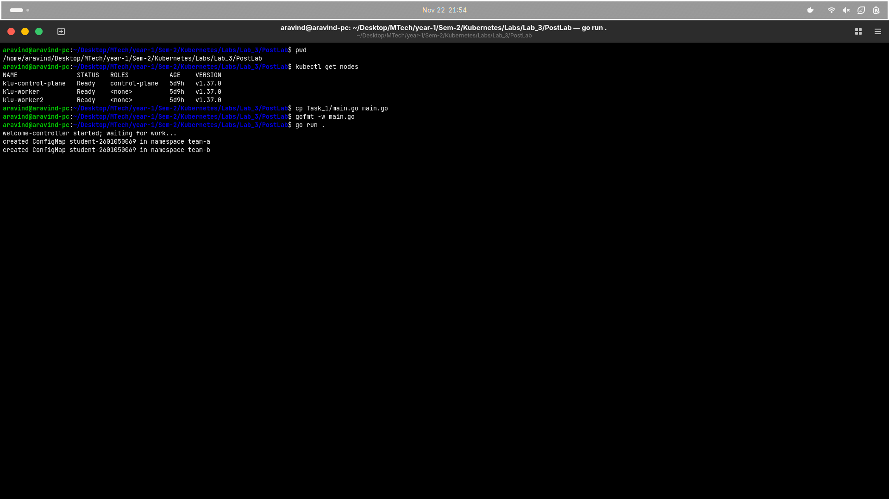
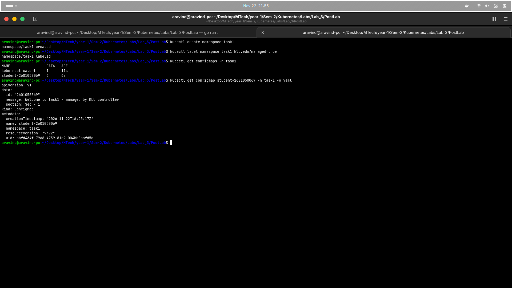
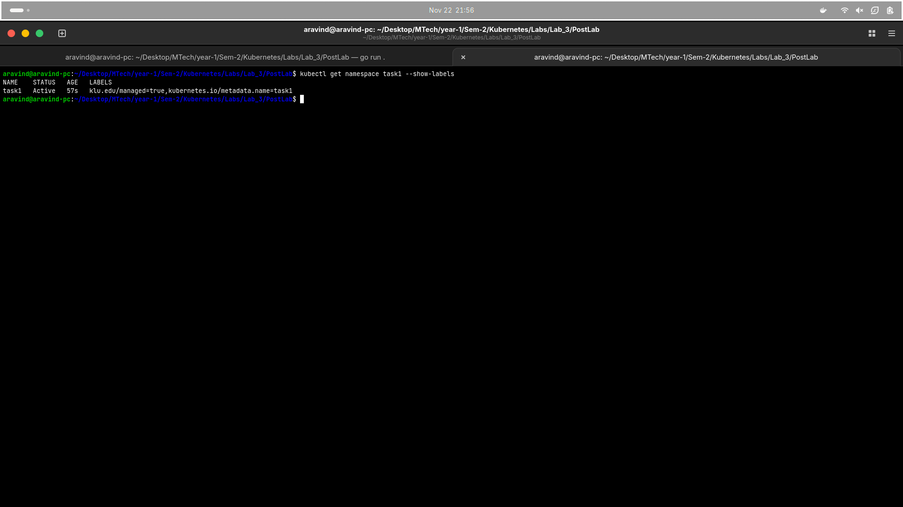
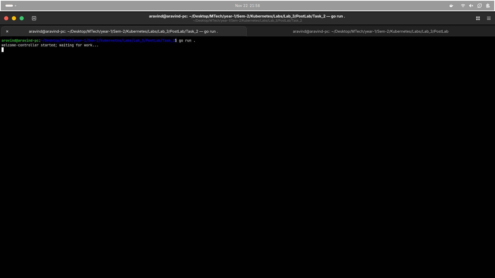
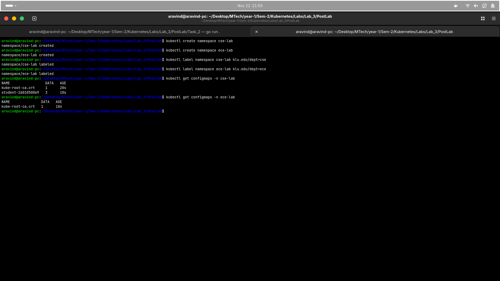
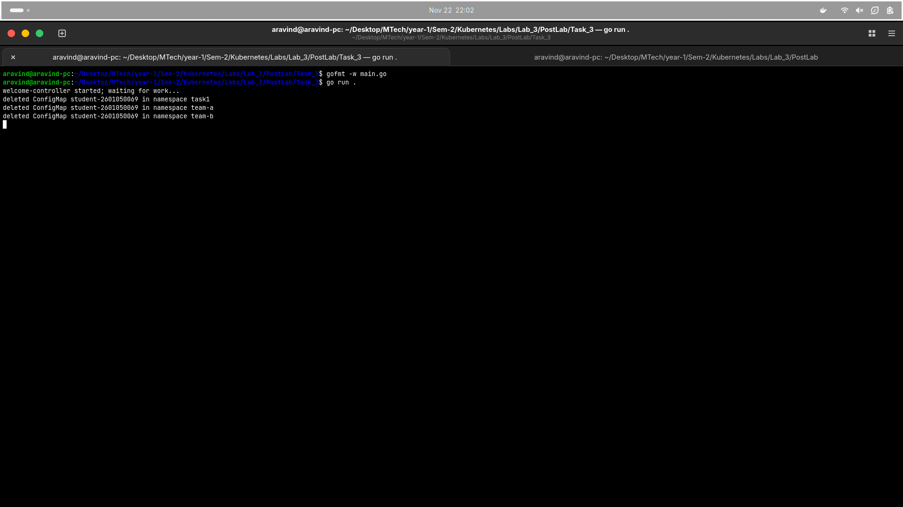
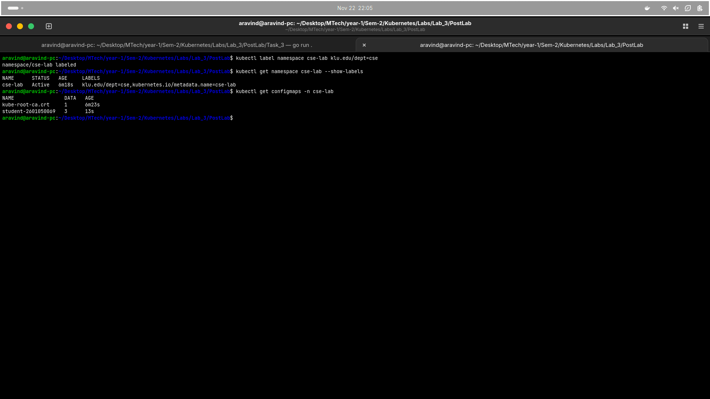
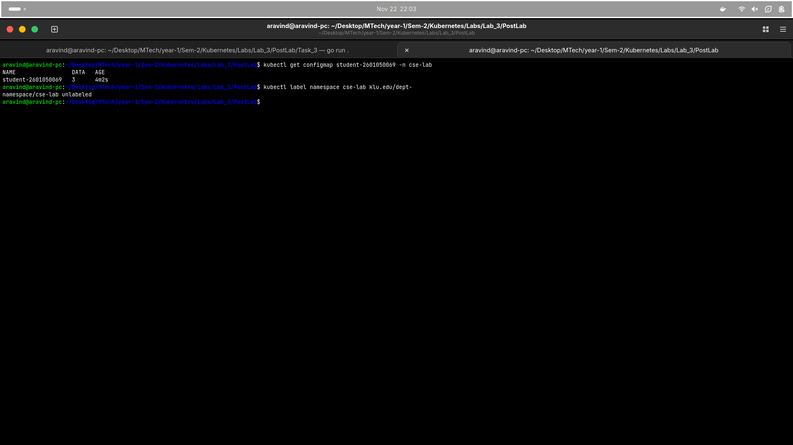
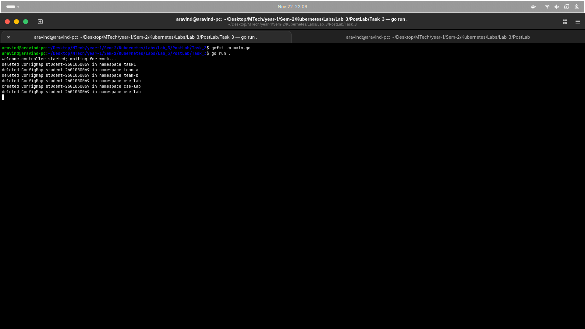

# Lab 3: Write Your First Controller – PostLab

**Course:** 26CS52B1E · Kubernetes and Container Orchestration  
**Program:** M.Tech CSE · Semester 2  
**Implementation:** Custom Kubernetes Controller Extensions (`client-go`)  

---

## Overview

The Post-Lab exercises extend the custom `welcome-controller` developed during the In-Lab session to address production-readiness requirements:
1. **Task 1: Custom ConfigMap Name & Student Metadata** – Transitioning from generic welcome ConfigMaps to personalized resources containing student identification and academic section metadata.
2. **Task 2: Namespace Department Label Filtering** – Restricting controller scope to department-specific namespaces using dedicated label keys and values (`klu.edu/dept=cse`).
3. **Task 3: Automated Resource Cleanup / Garbage Collection** – Resolving the design limitation identified in Experiment D by implementing automatic ConfigMap deletion when a namespace's management label is removed.

---

## Tasks Performed

### Task 1: Create Your Own ConfigMap with Student Metadata

- **Objective:** Modify the controller to generate a ConfigMap named after student ID `student-2601050069` carrying custom fields (`id`, `section`, and `message`) inside namespaces labelled with `klu.edu/managed=true`.
- **Source File:** [`Task_1/main.go`](Task_1/main.go)
- **Key Code Modifications:**
  ```go
  const managedLabel = "klu.edu/managed"
  const cmName = "student-2601050069"

  // Inside reconcile():
  cm := &corev1.ConfigMap{
      ObjectMeta: metav1.ObjectMeta{Name: cmName, Namespace: name},
      Data: map[string]string{
          "message": "Welcome to " + name + " - managed by KLU controller",
          "id":      "2601050069",
          "section": "Sec - 1",
      },
  }
  ```

#### Step 1: Controller Execution & Startup
- **Why and what we are doing:** Copy `Task_1/main.go` to the working directory, format the code, and launch the controller process in Terminal 1.
```bash
cp Task_1/main.go main.go
gofmt -w main.go
go run .
```
*Observation:* The controller starts and reconciles existing managed namespaces (`team-a`, `team-b`).


#### Step 2: Provision Namespace and Verify Metadata in ConfigMap
- **Why and what we are doing:** In Terminal 2, create a new namespace `task1`, apply the management label `klu.edu/managed=true`, and inspect the generated ConfigMap YAML.
```bash
kubectl create namespace task1
kubectl label namespace task1 klu.edu/managed=true
kubectl get configmaps -n task1
kubectl get configmap student-2601050069 -n task1 -o yaml
```
*Observation:* The controller detects the newly labelled namespace and provisions `student-2601050069` containing the custom student metadata payload.


#### Step 3: Verify Namespace Management Label
- **Why and what we are doing:** Inspect namespace metadata to verify that `klu.edu/managed=true` is correctly applied.
```bash
kubectl get namespace task1 --show-labels
```


---

### Task 2: Namespace Department Label Filtering (`klu.edu/dept=cse`)

- **Objective:** Update the controller logic so that it only reconciles namespaces labelled with department identifier `klu.edu/dept=cse`, explicitly ignoring namespaces assigned to other departments (e.g., `ece`).
- **Source File:** [`Task_2/main.go`](Task_2/main.go)
- **Key Code Modifications:**
  ```go
  const managedLabel = "klu.edu/dept"
  const cmName = "student-2601050069"

  // Inside reconcile():
  if ns.Labels[managedLabel] != "cse" {
      return nil // not managed by us: leave it alone
  }
  ```

#### Step 1: Start Filtered Controller
- **Why and what we are doing:** Run the controller from the `Task_2` directory and observe the waiting state.
```bash
cd Task_2
go run .
```


#### Step 2: Multi-Department Namespace Creation & Verification
- **Why and what we are doing:** Create two separate departmental namespaces (`cse-lab` and `ece-lab`). Apply `klu.edu/dept=cse` to `cse-lab` and `klu.edu/dept=ece` to `ece-lab`. Check both namespaces to confirm selective provisioning.
```bash
kubectl create namespace cse-lab
kubectl create namespace ece-lab

kubectl label namespace cse-lab klu.edu/dept=cse
kubectl label namespace ece-lab klu.edu/dept=ece

# Verify selective creation
kubectl get configmaps -n cse-lab
kubectl get configmaps -n ece-lab
```
*Observation:* `cse-lab` contains the newly created `student-2601050069` ConfigMap, whereas `ece-lab` contains only the default cluster certificate (`kube-root-ca.crt`). This confirms that the controller strictly filters by label key and value.


---

### Task 3: Automatic Cleanup / Garbage Collection Upon Label Removal

- **Objective:** Fix the orphan resource gap from InLab Experiment D. When a namespace loses the label `klu.edu/dept=cse`, the controller must actively delete the ConfigMap `student-2601050069` from that namespace.
- **Source File:** [`Task_3/main.go`](Task_3/main.go)
- **Key Code Modifications:**
  ```go
  if ns.Labels[managedLabel] != "cse" {
      err := client.CoreV1().ConfigMaps(name).Delete(
          context.Background(),
          cmName,
          metav1.DeleteOptions{},
      )

      if apierrors.IsNotFound(err) {
          return nil // already deleted: desired state achieved
      }

      if err != nil {
          return err // transient failure: retry
      }

      fmt.Println("deleted ConfigMap", cmName, "in namespace", name)
      return nil
  }
  ```

#### Step 1: Controller Startup and Automatic State Correction
- **Why and what we are doing:** Format and start the controller in `Task_3`. On startup, during cache synchronization, the controller reconciles existing namespaces and actively deletes orphan ConfigMaps from namespaces that no longer have the `klu.edu/dept=cse` label (`task1`, `team-a`, `team-b`).
```bash
gofmt -w main.go
go run .
```
*Console Log Output:*
```text
welcome-controller started; waiting for work...
deleted ConfigMap student-2601050069 in namespace task1
deleted ConfigMap student-2601050069 in namespace team-a
deleted ConfigMap student-2601050069 in namespace team-b
```


#### Step 2: Provision & Verify Active ConfigMap in Managed Namespace
- **Why and what we are doing:** Ensure `cse-lab` is labelled with `klu.edu/dept=cse` and verify the ConfigMap is present.
```bash
kubectl label namespace cse-lab klu.edu/dept=cse
kubectl get namespace cse-lab --show-labels
kubectl get configmaps -n cse-lab
```


#### Step 3: Remove Management Label
- **Why and what we are doing:** Remove the departmental label from `cse-lab` using `kubectl label namespace cse-lab klu.edu/dept-`.
```bash
kubectl get configmap student-2601050069 -n cse-lab
kubectl label namespace cse-lab klu.edu/dept-
```


#### Step 4: Verify Controller Deletion Logs
- **Why and what we are doing:** Inspect Terminal 1 to confirm that the Namespace `UpdateFunc` event handler enqueued `cse-lab`, triggering `reconcile()` to execute the deletion call against the API server.
*Controller Output:*
```text
deleted ConfigMap student-2601050069 in namespace cse-lab
```


---

## Summary of PostLab Implementations

| Task | Configuration | Reconcile Behavior | Idempotency & Safety |
| :--- | :--- | :--- | :--- |
| **Task 1** | `managedLabel = "klu.edu/managed"`, `cmName = "student-2601050069"` | Creates student ConfigMap with `id`, `section`, and `message` payload. | Uses `apierrors.IsAlreadyExists` check on creation. |
| **Task 2** | `managedLabel = "klu.edu/dept"`, filter `ns.Labels[managedLabel] == "cse"` | Selectively creates ConfigMap only in matching department namespaces (`cse-lab`). | Ignores non-matching namespaces (`ece-lab`) without error. |
| **Task 3** | Cleanup on `ns.Labels[managedLabel] != "cse"` | Deletes `student-2601050069` upon label removal or startup drift. | Uses `apierrors.IsNotFound` check to ensure delete idempotency. |
