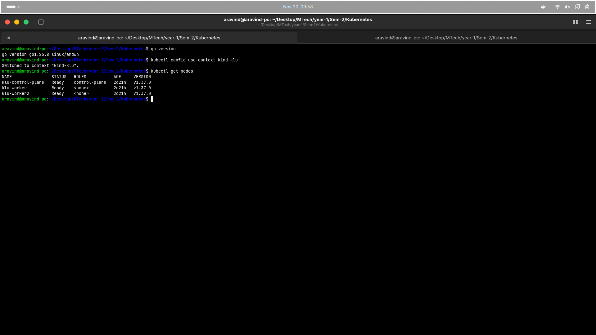
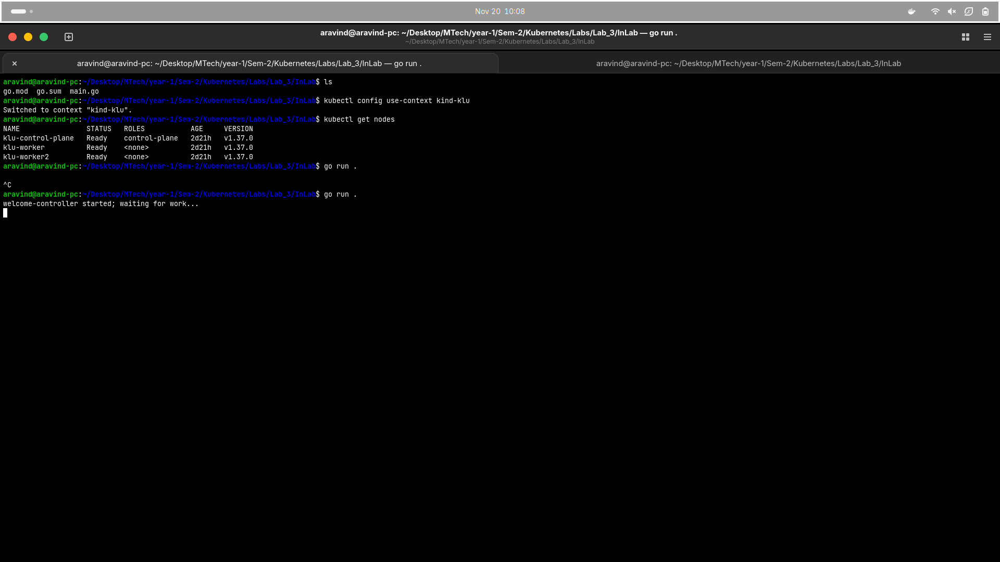
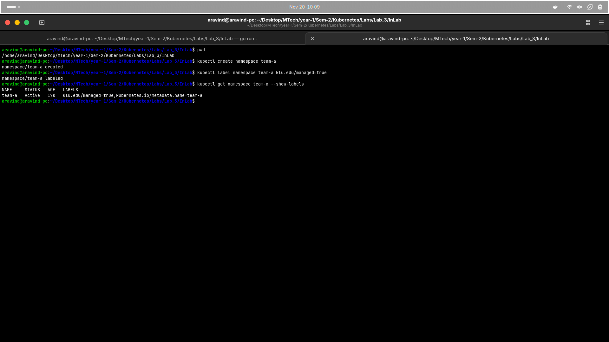
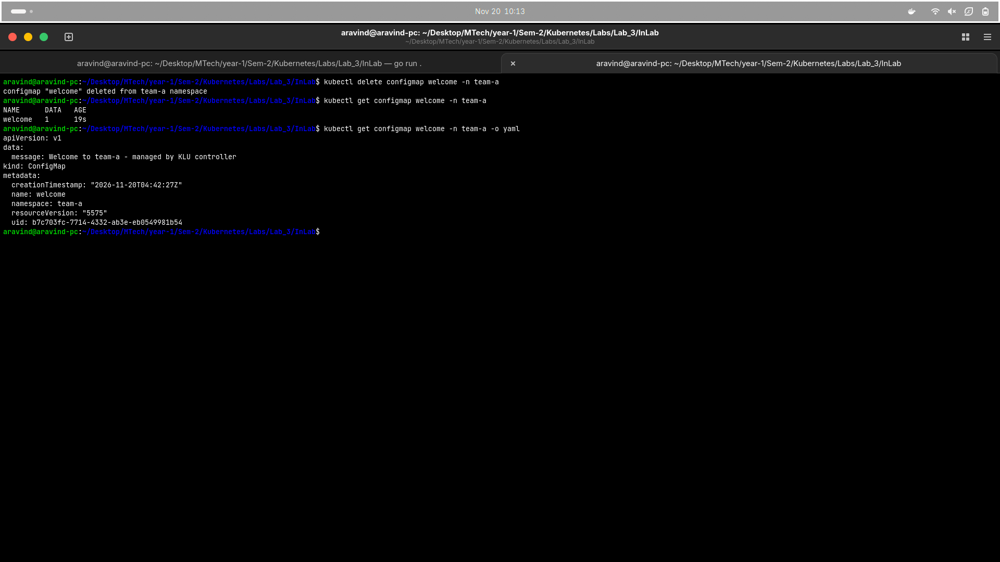
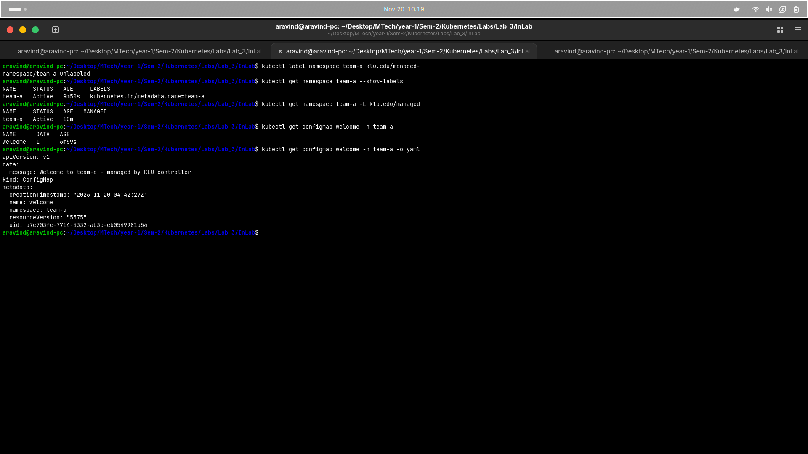
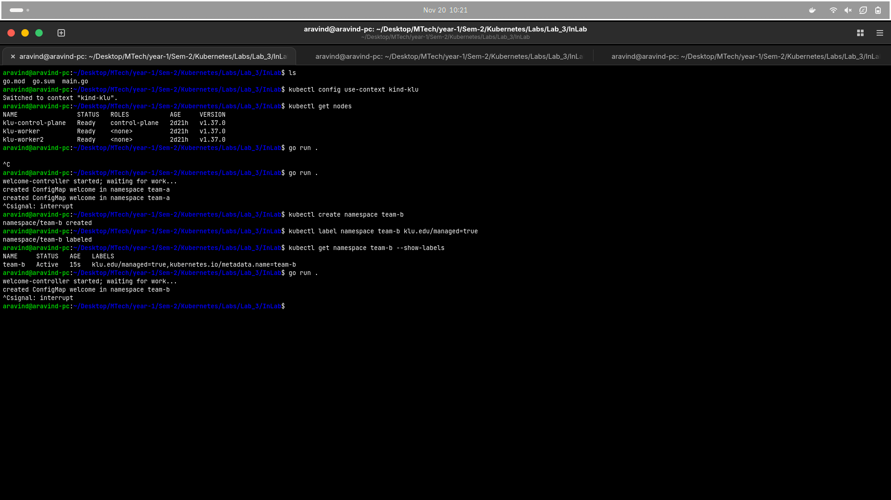
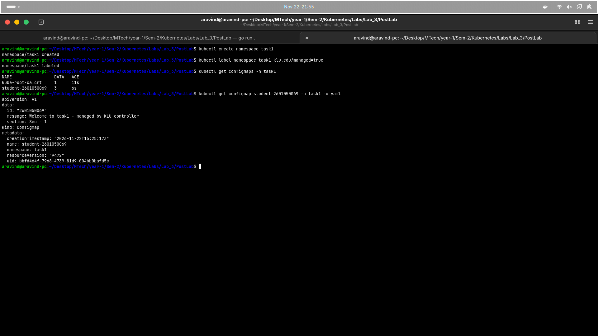
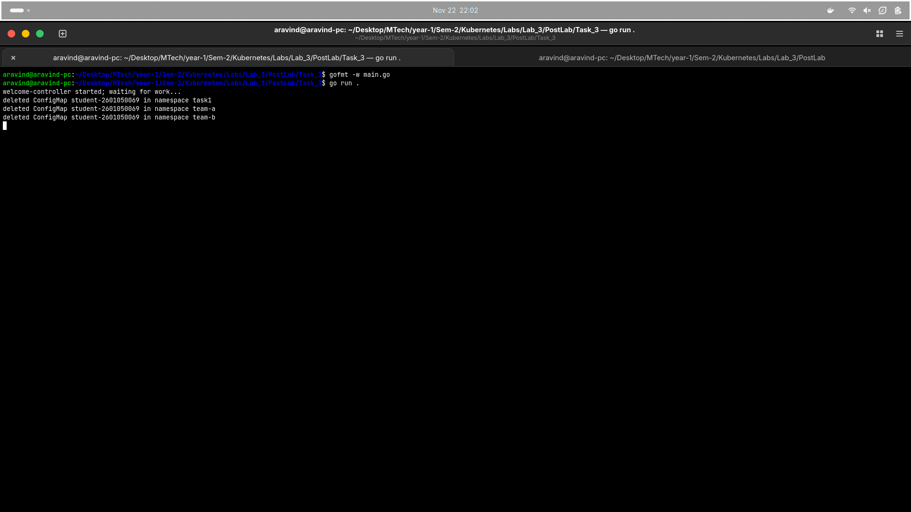
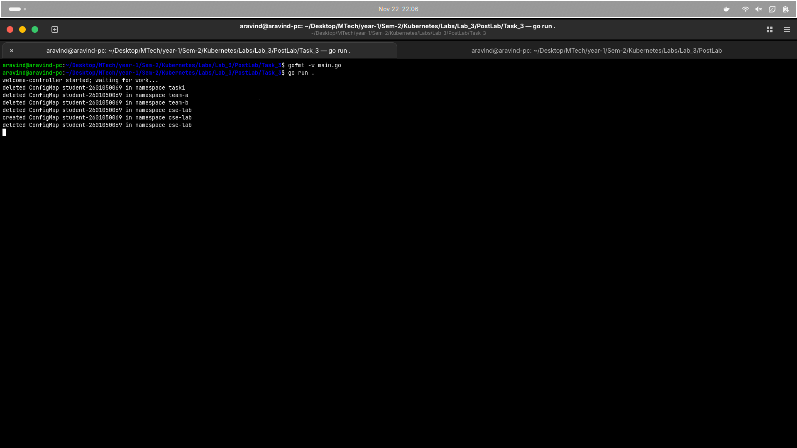

# Lab 3: Write Your First Controller

## Architecture & Controller Overview

A Kubernetes controller continuously drives the **actual state** of a cluster toward the user-defined **desired state**. Unlike request-response systems, controllers are control loops that operate asynchronously using three core building blocks:

```text
┌─────────────────────────────────────────────────────────────────────────────┐
│                           Custom Welcome Controller                         │
│                                                                             │
│  ┌────────────────────────┐      ┌──────────────┐      ┌─────────────────┐  │
│  │     Informers (Eyes)   │ ───> │  Work Queue  │ ───> │ Reconcile Function │
│  │   Namespaces & CMs     │      │ (To-Do List) │      │     (Hands)     │
│  │ (List + Watch + Cache) │      │              │      │                 │
│  └────────────────────────┘      └──────────────┘      └─────────────────┘  │
│               │                                                 │           │
└───────────────┼─────────────────────────────────────────────────┼───────────┘
                │ Watch Streams                                   │ Writes
                ▼                                                 ▼
┌─────────────────────────────────────────────────────────────────────────────┐
│                        Kubernetes API Server (etcd)                         │
└─────────────────────────────────────────────────────────────────────────────┘
```

- **Informer (The Eyes):** Establishes an HTTP streaming watch on the API Server and populates an in-memory local cache. Queries read from local cache rather than overloading the API server.
- **Work Queue (The To-Do List):** A typed rate-limiting queue storing resource keys (`namespace-name`), deduplicating rapid triggers and applying exponential back-off on failures.
- **Reconcile Loop (The Hands):** An idempotent worker function that inspects actual state, compares it with the desired state rule, and fixes any detected drift.

### Core Controller Rule
> **Desired State:** Every Kubernetes Namespace carrying the label `klu.edu/managed=true` must contain a ConfigMap named `welcome` containing:
> ```yaml
> data:
>   message: Welcome to <namespace-name> - managed by KLU controller
> ```

---

## InLab

### Question 1: Implement and verify a custom Kubernetes controller in Go using `client-go` to manage ConfigMaps across labelled namespaces.

#### Step 1: Environment & Cluster Verification
- **Why and what we are doing:** Verify that Go compiler (`go1.26.8 linux/amd64` or newer) is operational, the Kubernetes context is pointing to the multi-node kind cluster (`kind-klu`), and all control-plane and worker nodes (`klu-control-plane`, `klu-worker`, `klu-worker2`) are in `Ready` status.
```bash
go version
kubectl config use-context kind-klu
kubectl get nodes
```


---

#### Step 2: Go Project Initialization & Dependency Resolution
- **Why and what we are doing:** Navigate to the `InLab` directory, initialize the Go module `welcome-controller`, and download the official Kubernetes client packages (`k8s.io/client-go`, `k8s.io/api`, `k8s.io/apimachinery` pinned at `v0.37.1`), followed by `go mod tidy` to resolve transitive dependencies.
```bash
cd Labs/Lab_3/InLab
go mod init welcome-controller
go get k8s.io/client-go@v0.37.1
go get k8s.io/api@v0.37.1
go get k8s.io/apimachinery@v0.37.1
go mod tidy
```


---

#### Step 3: Controller Startup & Informer Cache Synchronization
- **Why and what we are doing:** Execute the Go controller. The controller reads cluster credentials from `~/.kube/config`, initializes Namespace and ConfigMap shared informers, registers event handlers, completes initial `LIST` cache synchronization (`WaitForCacheSync`), and starts listening on the rate-limiting queue.
```bash
# Terminal 1 (Controller Process)
go run .
```
*Expected Console Output:*
```text
welcome-controller started; waiting for work...
```


---

#### Step 4: Namespace Provisioning & Management Labelling
- **Why and what we are doing:** In a separate terminal window, create an unmanaged namespace `team-a`, apply the management label `klu.edu/managed=true`, and verify that the label is persisted in the namespace metadata.
```bash
# Terminal 2 (kubectl Operations)
kubectl create namespace team-a
kubectl label namespace team-a klu.edu/managed=true
kubectl get namespace team-a --show-labels
```


---

#### Step 5: Verification of Automatic ConfigMap Creation
- **Why and what we are doing:** Verify that the controller's Namespace `AddFunc`/`UpdateFunc` event handler enqueued `team-a`, triggered `reconcile()`, and successfully created the desired `welcome` ConfigMap with the formatted greeting payload.
```bash
kubectl get configmap welcome -n team-a
kubectl get configmap welcome -n team-a -o yaml
```
*Generated ConfigMap Output:*
```yaml
apiVersion: v1
data:
  message: Welcome to team-a - managed by KLU controller
kind: ConfigMap
metadata:
  name: welcome
  namespace: team-a
```


---

#### Step 6: Experiment A – Self-Healing Mechanism
- **Why and what we are doing:** Simulate state drift by manually deleting the `welcome` ConfigMap in `team-a`. The controller's ConfigMap `DeleteFunc` event handler immediately intercepts the deletion of any ConfigMap named `welcome`, enqueues the parent namespace, and `reconcile()` automatically restores the missing ConfigMap.
```bash
# Delete the active ConfigMap
kubectl delete configmap welcome -n team-a

# Verify immediate automated recreation (self-healing)
kubectl get configmap welcome -n team-a
kubectl get configmap welcome -n team-a -o yaml
```
*Observation:* A new ConfigMap is created within seconds with a new `resourceVersion` and `uid`, proving active reconciliation and drift correction.


---

#### Step 7: Experiment B – Catching Up After Controller Downtime
- **Why and what we are doing:** Terminate the controller process using `Ctrl+C` to simulate controller downtime. While offline, create and label a second namespace `team-b`. Restart the controller with `go run .` and observe that the controller synchronizes state during the initial startup `LIST` call.
```bash
# Terminal 1: Stop controller with Ctrl+C

# Terminal 2: Provision while controller is offline
kubectl create namespace team-b
kubectl label namespace team-b klu.edu/managed=true

# Terminal 1: Restart controller
go run .

# Terminal 2: Verify caught-up state
kubectl get configmap welcome -n team-b
kubectl get configmap welcome -n team-b -o yaml
```
*Observation:* Because Kubernetes controllers are **level-triggered** (reacting to current cluster state rather than missing discrete events), the informer's initial cache sync automatically identifies the unmanaged `team-b` namespace and creates its `welcome` ConfigMap immediately upon restart.


---

#### Step 8: Experiment C – Multiple Controllers & Idempotency
- **Why and what we are doing:** Launch two concurrent instances of `welcome-controller` in parallel terminals. Both controllers watch the same namespaces and attempt reconciliation.
```bash
# Verify both namespaces contain exactly one welcome ConfigMap
kubectl get configmap welcome -n team-a
kubectl get configmap welcome -n team-b
kubectl get configmaps -n team-a
kubectl get configmaps -n team-b
```
*Technical Mechanism:* The controller handles duplicate creation attempts safely through optimistic error checks in `main.go`:
```go
_, err = client.CoreV1().ConfigMaps(name).Create(context.Background(), cm, metav1.CreateOptions{})
if apierrors.IsAlreadyExists(err) {
    return nil // already there: actual state == desired state
}
```
Because the API server enforces resource name uniqueness per namespace and the controller treats `AlreadyExists` as a success condition (`nil` error), running multiple controllers is strictly idempotent and causes no conflicting state or duplicate resources.


---

#### Step 9: Experiment D – Label Removal & Deletion Semantics
- **Why and what we are doing:** Remove the management label `klu.edu/managed-` from `team-a` and check whether the `welcome` ConfigMap is deleted or preserved.
```bash
# Remove label from namespace
kubectl label namespace team-a klu.edu/managed-

# Verify label is removed
kubectl get namespace team-a --show-labels
kubectl get namespace team-a -L klu.edu/managed

# Inspect ConfigMap status
kubectl get configmap welcome -n team-a
kubectl get configmap welcome -n team-a -o yaml
```
*Observation & Design Finding:* The `welcome` ConfigMap remains intact inside `team-a`. The controller logic explicitly checks if `ns.Labels[managedLabel] != "true"` and returns `nil` (noop). It does not implement automated garbage collection or cascading deletion upon unlabelling.


---

#### Step 10: Controller Execution Logs & Lifecycle Trace
- **Why and what we are doing:** Inspect the comprehensive execution trace of the Go controller process showing startup, initial namespace reconciliation for `team-a`, recovery logs, and subsequent catch-up creation for `team-b`.
```bash
go run .
```
*Captured Controller Lifecycle Output:*
```text
welcome-controller started; waiting for work...
created ConfigMap welcome in namespace team-a
created ConfigMap welcome in namespace team-a
^Csignal: interrupt
...
welcome-controller started; waiting for work...
created ConfigMap welcome in namespace team-b
^Csignal: interrupt
```


---

## Source Code Reference

The controller is implemented in [`InLab/main.go`](InLab/main.go). Key architectural segments:

| Section | Lines | Component & Purpose |
| :--- | :--- | :--- |
| **Client Setup** | Lines 29–36 | Uses `clientcmd.BuildConfigFromFlags` to load credentials from `~/.kube/config` and creates `kubernetes.NewForConfigOrDie(config)`. |
| **Informer Factory** | Lines 38–41 | Creates `informers.NewSharedInformerFactory` with a 10-minute resync interval for `Namespaces` and `ConfigMaps`. |
| **Rate-Limiting Queue** | Lines 43–45 | Instantiates `workqueue.NewTypedRateLimitingQueue[string]()` to store namespace names (keys). |
| **Event Handlers** | Lines 47–57 | `nsInformer` pushes namespace keys on Add/Update; `cmInformer` pushes parent namespace key on ConfigMap deletion. |
| **Cache Sync & Loop** | Lines 59–74 | Blocks until `cache.WaitForCacheSync` returns true, then launches `wait.Until` calling `processNextItem`. |
| **Worker Processing** | Lines 76–93 | `processNextItem()` gets keys, calls `reconcile()`, manages `queue.Forget()` on success, or `queue.AddRateLimited()` on failure. |
| **Reconcile Function** | Lines 95–121 | Reads namespace from cache (`lister.Get`), evaluates `klu.edu/managed` label, issues `Create`, and ignores `IsAlreadyExists`. |

---

## PostLab

### Question 1: Create your own ConfigMap with student identification metadata.

#### Step 1: Controller Modification & Startup
- **Why and what we are doing:** Launch the modified controller from [`PostLab/Task_1/main.go`](PostLab/Task_1/main.go) configured with custom ConfigMap name `student-2601050069` and student metadata payload.
```bash
cp Task_1/main.go main.go
gofmt -w main.go
go run .
```


#### Step 2: Namespace Provisioning & ConfigMap Inspection
- **Why and what we are doing:** Create namespace `task1`, apply the management label `klu.edu/managed=true`, and inspect the generated ConfigMap YAML to verify student ID (`2601050069`), section (`Sec - 1`), and greeting message.
```bash
kubectl create namespace task1
kubectl label namespace task1 klu.edu/managed=true
kubectl get configmaps -n task1
kubectl get configmap student-2601050069 -n task1 -o yaml
```


#### Step 3: Verify Namespace Management Label
- **Why and what we are doing:** Verify that the `klu.edu/managed=true` label is present in the namespace metadata.
```bash
kubectl get namespace task1 --show-labels
```


---

### Question 2: Implement department-based namespace filtering (`klu.edu/dept=cse`).

#### Step 1: Launch Department-Filtered Controller
- **Why and what we are doing:** Run the controller configured with `managedLabel = "klu.edu/dept"` and department check `ns.Labels[managedLabel] != "cse"` from [`PostLab/Task_2/main.go`](PostLab/Task_2/main.go).
```bash
cd Task_2
go run .
```


#### Step 2: Multi-Department Namespace Creation & Selective Provisioning Verification
- **Why and what we are doing:** Create `cse-lab` and `ece-lab` namespaces. Label `cse-lab` with `klu.edu/dept=cse` and `ece-lab` with `klu.edu/dept=ece`. Verify that the ConfigMap is created only in `cse-lab` and ignored in `ece-lab`.
```bash
kubectl create namespace cse-lab
kubectl create namespace ece-lab
kubectl label namespace cse-lab klu.edu/dept=cse
kubectl label namespace ece-lab klu.edu/dept=ece
kubectl get configmaps -n cse-lab
kubectl get configmaps -n ece-lab
```


---

### Question 3: Implement automated cleanup and garbage collection upon label removal.

#### Step 1: Controller Startup & Automatic State Correction
- **Why and what we are doing:** Start the cleanup-enabled controller from [`PostLab/Task_3/main.go`](PostLab/Task_3/main.go). During startup cache sync, the controller reconciles existing namespaces and actively deletes orphan ConfigMaps from namespaces that do not match `klu.edu/dept=cse`.
```bash
gofmt -w main.go
go run .
```


#### Step 2: Label Managed Namespace & Verify ConfigMap Creation
- **Why and what we are doing:** Label `cse-lab` with `klu.edu/dept=cse` and verify that the `student-2601050069` ConfigMap is created.
```bash
kubectl label namespace cse-lab klu.edu/dept=cse
kubectl get namespace cse-lab --show-labels
kubectl get configmaps -n cse-lab
```


#### Step 3: Remove Department Management Label
- **Why and what we are doing:** Remove the management label from `cse-lab` (`kubectl label namespace cse-lab klu.edu/dept-`) to trigger the controller's automated cleanup logic.
```bash
kubectl get configmap student-2601050069 -n cse-lab
kubectl label namespace cse-lab klu.edu/dept-
```


#### Step 4: Verify Controller Event Handlers & Automated Deletion Logs
- **Why and what we are doing:** Inspect the controller terminal logs to verify that the namespace update event was intercepted, calling `client.CoreV1().ConfigMaps(name).Delete()` to remove the orphan ConfigMap.
```bash
# Terminal 1 Controller Log Output
# deleted ConfigMap student-2601050069 in namespace cse-lab
```
