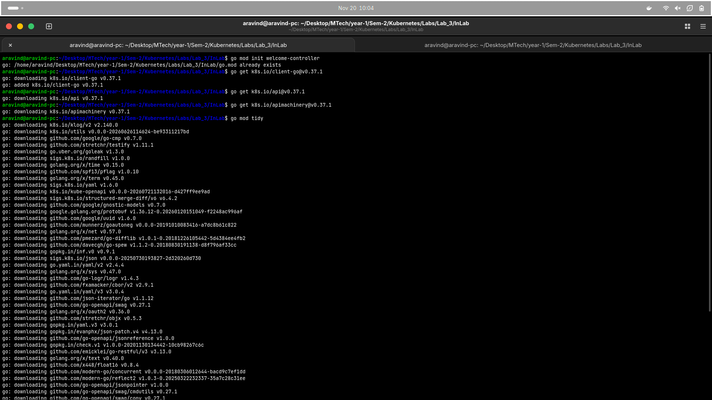
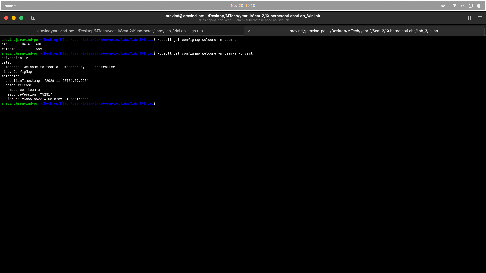
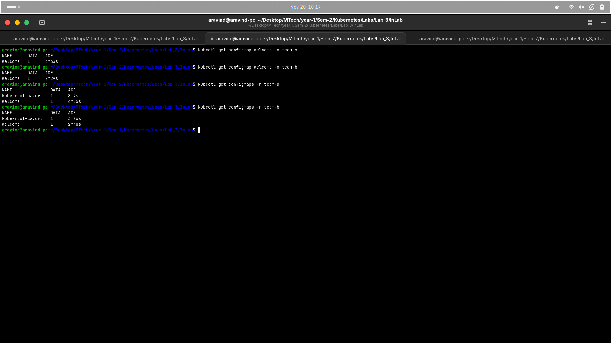
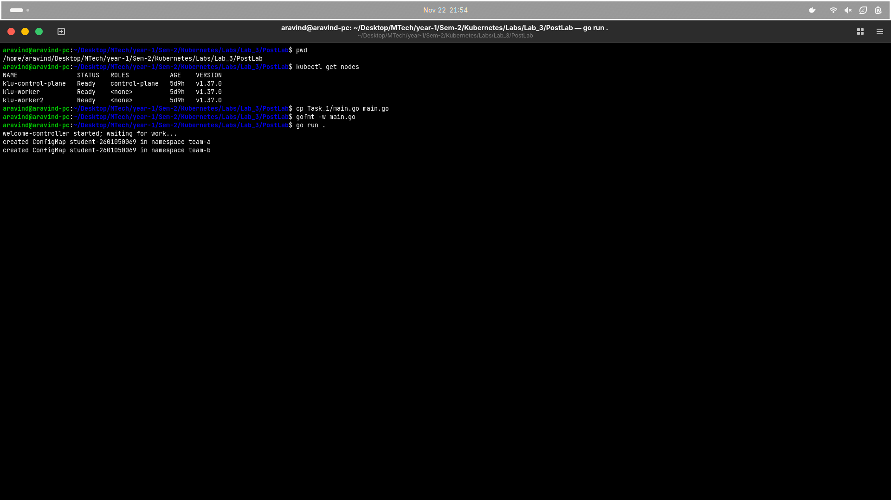
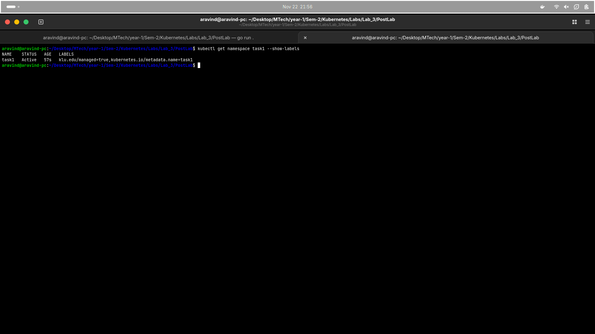
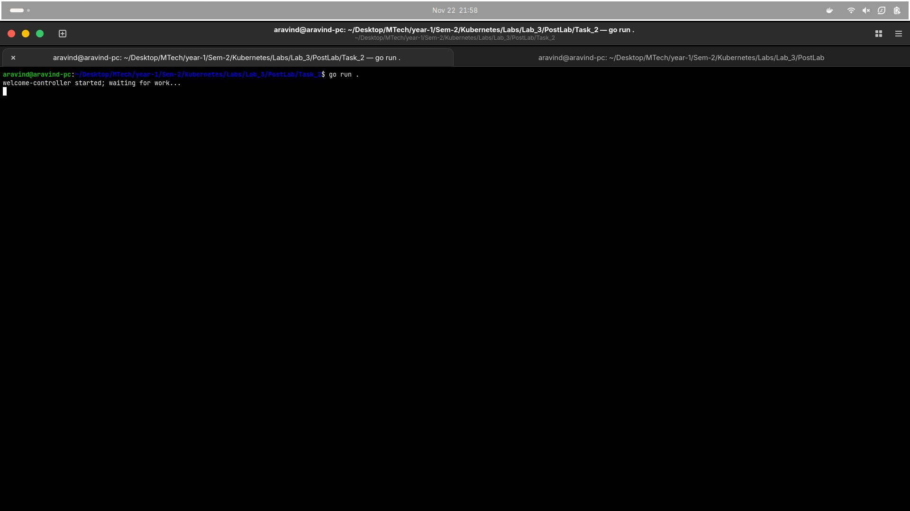
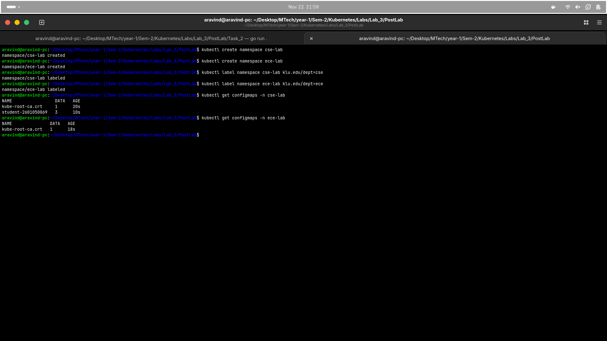
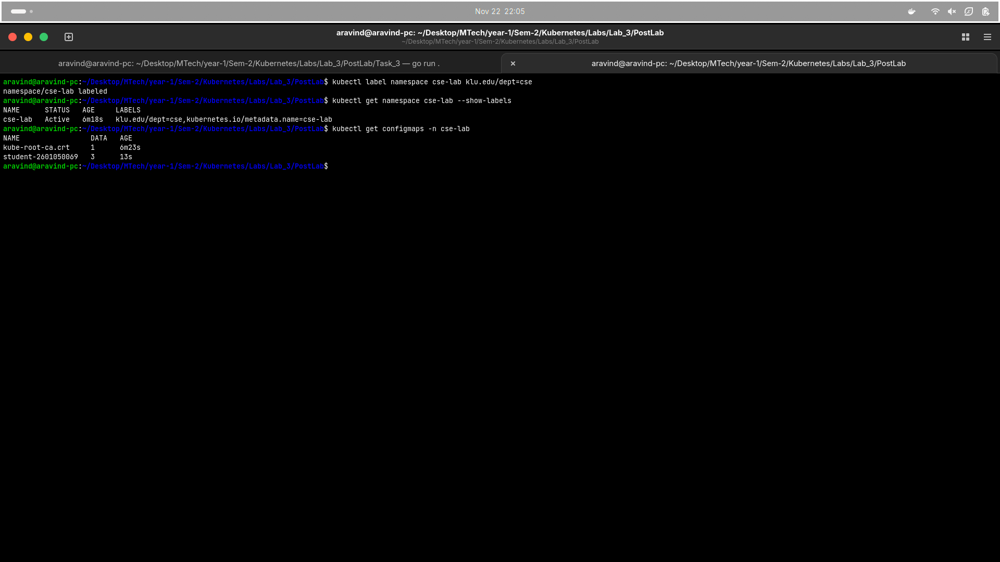
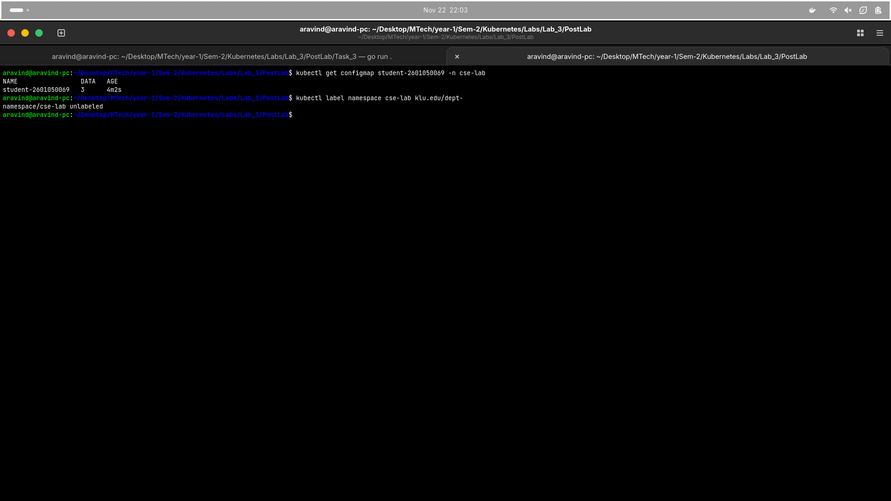

# Lab 3: Write Your First Controller

## How a Controller Works

Before writing any Go code, I tried to picture a Kubernetes controller like a room thermostat: you set it to 24°C (desired state), and if someone opens a window and the room warms up (actual state drifts), the AC kicks back in without you pressing anything.

Our controller has three moving parts:
- **Informer (The Eyes):** Opens a live watch stream to the API server and keeps a fast local cache, so we don't spam the API server every second.
- **Work Queue (The To-Do List):** Holds just the names of namespaces that need checking, deduplicating repeats and backing off if something fails.
- **Reconcile Loop (The Hands):** Checks one namespace at a time and fixes any mismatch between what we want and what's actually in the cluster.

### The Rule We're Teaching Kubernetes
I wanted every Namespace carrying the label `klu.edu/managed=true` (I used `klu.edu` for my university—you can use your own domain or prefix like `myapp.io/managed=true`) to automatically get a ConfigMap named `welcome`:
```yaml
data:
  message: Welcome to <namespace-name> - managed by KLU controller
```

---

## InLab

### Question 1: Implement and verify a custom Kubernetes controller in Go using `client-go` to manage ConfigMaps across labelled namespaces.

#### Step 1: Environment & Cluster Verification
- **Why and what we are doing:** First, I checked that Go (`1.26.8`) was installed and that my `kind-klu` cluster had all three nodes `Ready`.
```bash
go version
kubectl config use-context kind-klu
kubectl get nodes
```


---

#### Step 2: Go Project Initialization & Dependency Resolution
- **Why and what we are doing:** I moved into `Lab_3/InLab`, initialized a Go module called `welcome-controller`, and pulled down `client-go`, `api`, and `apimachinery` (`v0.37.1`), then ran `go mod tidy` so `go.mod` matched what `main.go` imports.
```bash
cd Labs/Lab_3/InLab
go mod init welcome-controller
go get k8s.io/client-go@v0.37.1
go get k8s.io/api@v0.37.1
go get k8s.io/apimachinery@v0.37.1
go mod tidy
```


---

#### Step 3: Controller Startup & Informer Cache Synchronization
- **Why and what we are doing:** When I ran `go run .`, the controller loaded `~/.kube/config` (just like `kubectl`), synced its local Namespace and ConfigMap caches, and printed `welcome-controller started; waiting for work...`.
```bash
go run .
```
*Expected Console Output:*
```text
welcome-controller started; waiting for work...
```


---

#### Step 4: Namespace Provisioning & Management Labelling
- **Why and what we are doing:** Leaving the controller running in the first terminal, I opened a second terminal, created `team-a`, and tagged it with `klu.edu/managed=true` to see if my code noticed.
```bash
kubectl create namespace team-a
kubectl label namespace team-a klu.edu/managed=true
kubectl get namespace team-a --show-labels
```


---

#### Step 5: Verification of Automatic ConfigMap Creation
- **Why and what we are doing:** Without creating any ConfigMap by hand, I checked `team-a`—sure enough, `welcome` was already there with the exact message for `team-a`.
```bash
kubectl get configmap welcome -n team-a
kubectl get configmap welcome -n team-a -o yaml
```
*Generated ConfigMap Output:*
```yaml
apiVersion: v1
data:
  message: Welcome to team-a - managed by KLU controller
kind: ConfigMap
metadata:
  name: welcome
  namespace: team-a
```


---

#### Step 6: Experiment A – Self-Healing Mechanism
- **Why and what we are doing:** Next, I tried breaking things on purpose: I deleted the `welcome` ConfigMap in `team-a`. Because `cmInformer` watches ConfigMap deletions and queues the parent namespace, my controller recreated `welcome` within a second with a brand-new `uid` and `resourceVersion`.
```bash
kubectl delete configmap welcome -n team-a
kubectl get configmap welcome -n team-a
kubectl get configmap welcome -n team-a -o yaml
```
*Observation:* A new ConfigMap appeared right away with a fresh `resourceVersion` and `uid`—my tiny controller was actually self-healing.


---

#### Step 7: Experiment B – Catching Up After Controller Downtime
- **Why and what we are doing:** I wanted to know what happens if my controller crashes or stops while someone labels a new namespace. I hit `Ctrl+C` to stop it, created and labelled `team-b` while it was offline, and then started `go run .` again.
```bash
kubectl create namespace team-b
kubectl label namespace team-b klu.edu/managed=true
go run .
kubectl get configmap welcome -n team-b
kubectl get configmap welcome -n team-b -o yaml
```
*Observation:* Even though the controller missed the moment `team-b` was labelled, the informer's initial `LIST` on startup discovered `team-b` and created its `welcome` ConfigMap immediately. That's what "level-triggered" means in practice: it reacts to current state, not missed events.


---

#### Step 8: Experiment C – Multiple Controllers & Idempotency
- **Why and what we are doing:** What if two copies of the controller run at the same time? I launched a second `go run .` in another terminal and checked both `team-a` and `team-b` to see if they fought or created duplicates.
```bash
kubectl get configmap welcome -n team-a
kubectl get configmap welcome -n team-b
kubectl get configmaps -n team-a
kubectl get configmaps -n team-b
```
*Technical Mechanism:* Both namespaces still had a single `welcome` ConfigMap and zero errors, because `reconcile()` treats Kubernetes' `AlreadyExists` error as "already done":
```go
_, err = client.CoreV1().ConfigMaps(name).Create(context.Background(), cm, metav1.CreateOptions{})
if apierrors.IsAlreadyExists(err) {
    return nil
}
```


---

#### Step 9: Experiment D – Label Removal & Deletion Semantics
- **Why and what we are doing:** Finally, I removed the `klu.edu/managed` label from `team-a` expecting `welcome` to disappear—and got a surprise.
```bash
kubectl label namespace team-a klu.edu/managed-
kubectl get namespace team-a --show-labels
kubectl get namespace team-a -L klu.edu/managed
kubectl get configmap welcome -n team-a
kubectl get configmap welcome -n team-a -o yaml
```
*Observation & Design Finding:* The `welcome` ConfigMap stayed behind! Looking back at `main.go`, when a namespace doesn't have the label, `reconcile()` simply returns `nil` without deleting anything. That's a real design gap we fix in PostLab Question 3.


---

#### Step 10: Controller Execution Logs & Lifecycle Trace
- **Why and what we are doing:** Looking back at the controller terminal shows the whole story in one place: starting up, creating `welcome` in `team-a`, stopping with `Ctrl+C`, and catching up on `team-b` after restart.
```bash
go run .
```
*Captured Controller Lifecycle Output:*
```text
welcome-controller started; waiting for work...
created ConfigMap welcome in namespace team-a
created ConfigMap welcome in namespace team-a
^Csignal: interrupt
...
welcome-controller started; waiting for work...
created ConfigMap welcome in namespace team-b
^Csignal: interrupt
```


---

## Source Code Reference

The controller is implemented in [`InLab/main.go`](InLab/main.go). Key architectural segments:

| Section | Lines | Component & Purpose |
| :--- | :--- | :--- |
| **Client Setup** | Lines 29–36 | Uses `clientcmd.BuildConfigFromFlags` to load credentials from `~/.kube/config` and creates `kubernetes.NewForConfigOrDie(config)`. |
| **Informer Factory** | Lines 38–41 | Creates `informers.NewSharedInformerFactory` with a 10-minute resync interval for `Namespaces` and `ConfigMaps`. |
| **Rate-Limiting Queue** | Lines 43–45 | Instantiates `workqueue.NewTypedRateLimitingQueue[string]()` to store namespace names (keys). |
| **Event Handlers** | Lines 47–57 | `nsInformer` pushes namespace keys on Add/Update; `cmInformer` pushes parent namespace key on ConfigMap deletion. |
| **Cache Sync & Loop** | Lines 59–74 | Blocks until `cache.WaitForCacheSync` returns true, then launches `wait.Until` calling `processNextItem`. |
| **Worker Processing** | Lines 76–93 | `processNextItem()` gets keys, calls `reconcile()`, manages `queue.Forget()` on success, or `queue.AddRateLimited()` on failure. |
| **Reconcile Function** | Lines 95–121 | Reads namespace from cache (`lister.Get`), evaluates `klu.edu/managed` label, issues `Create`, and ignores `IsAlreadyExists`. |

---

## PostLab

### Question 1: Create your own ConfigMap with student identification metadata.

#### Step 1: Controller Modification & Startup
- **Why and what we are doing:** Launch the modified controller from [`PostLab/Task_1/main.go`](PostLab/Task_1/main.go) configured with custom ConfigMap name `student-2601050069` and student metadata payload.
```bash
cp Task_1/main.go main.go
gofmt -w main.go
go run .
```


#### Step 2: Namespace Provisioning & ConfigMap Inspection
- **Why and what we are doing:** Create namespace `task1`, apply the management label `klu.edu/managed=true`, and inspect the generated ConfigMap YAML to verify student ID (`2601050069`), section (`Sec - 1`), and greeting message.
```bash
kubectl create namespace task1
kubectl label namespace task1 klu.edu/managed=true
kubectl get configmaps -n task1
kubectl get configmap student-2601050069 -n task1 -o yaml
```


#### Step 3: Verify Namespace Management Label
- **Why and what we are doing:** Verify that the `klu.edu/managed=true` label is present in the namespace metadata.
```bash
kubectl get namespace task1 --show-labels
```


---

### Question 2: Implement department-based namespace filtering (`klu.edu/dept=cse`).

#### Step 1: Launch Department-Filtered Controller
- **Why and what we are doing:** Run the controller configured with `managedLabel = "klu.edu/dept"` and department check `ns.Labels[managedLabel] != "cse"` from [`PostLab/Task_2/main.go`](PostLab/Task_2/main.go).
```bash
cd Task_2
go run .
```


#### Step 2: Multi-Department Namespace Creation & Selective Provisioning Verification
- **Why and what we are doing:** Create `cse-lab` and `ece-lab` namespaces. Label `cse-lab` with `klu.edu/dept=cse` and `ece-lab` with `klu.edu/dept=ece`. Verify that the ConfigMap is created only in `cse-lab` and ignored in `ece-lab`.
```bash
kubectl create namespace cse-lab
kubectl create namespace ece-lab
kubectl label namespace cse-lab klu.edu/dept=cse
kubectl label namespace ece-lab klu.edu/dept=ece
kubectl get configmaps -n cse-lab
kubectl get configmaps -n ece-lab
```


---

### Question 3: Implement automated cleanup and garbage collection upon label removal.

#### Step 1: Controller Startup & Automatic State Correction
- **Why and what we are doing:** Start the cleanup-enabled controller from [`PostLab/Task_3/main.go`](PostLab/Task_3/main.go). During startup cache sync, the controller reconciles existing namespaces and actively deletes orphan ConfigMaps from namespaces that do not match `klu.edu/dept=cse`.
```bash
gofmt -w main.go
go run .
```


#### Step 2: Label Managed Namespace & Verify ConfigMap Creation
- **Why and what we are doing:** Label `cse-lab` with `klu.edu/dept=cse` and verify that the `student-2601050069` ConfigMap is created.
```bash
kubectl label namespace cse-lab klu.edu/dept=cse
kubectl get namespace cse-lab --show-labels
kubectl get configmaps -n cse-lab
```


#### Step 3: Remove Department Management Label
- **Why and what we are doing:** Remove the management label from `cse-lab` (`kubectl label namespace cse-lab klu.edu/dept-`) to trigger the controller's automated cleanup logic.
```bash
kubectl get configmap student-2601050069 -n cse-lab
kubectl label namespace cse-lab klu.edu/dept-
```


#### Step 4: Verify Controller Event Handlers & Automated Deletion Logs
- **Why and what we are doing:** Inspect the controller terminal logs to verify that the namespace update event was intercepted, calling `client.CoreV1().ConfigMaps(name).Delete()` to remove the orphan ConfigMap.
```bash
# Terminal 1 Controller Log Output
# deleted ConfigMap student-2601050069 in namespace cse-lab
```
