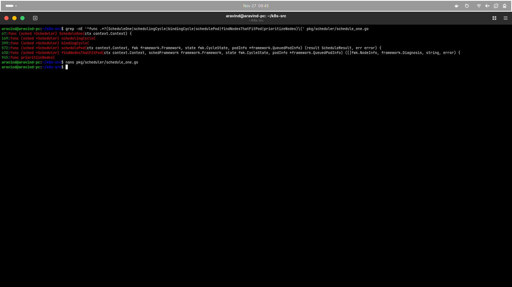
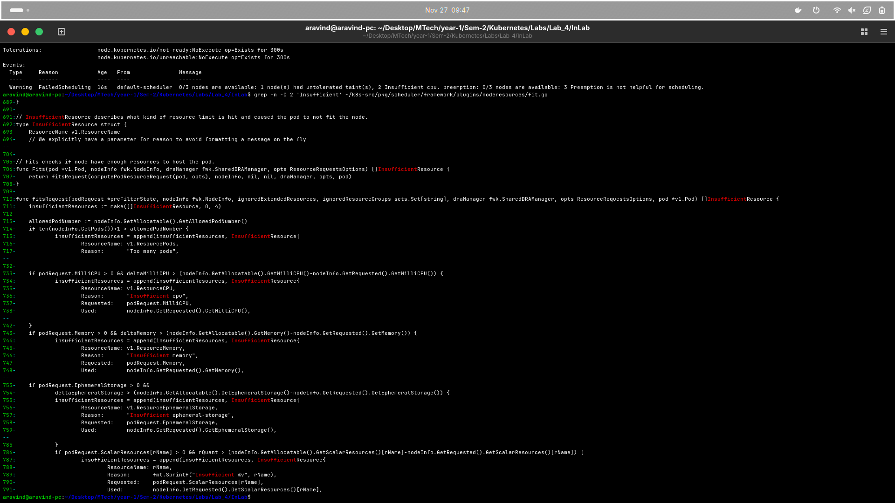
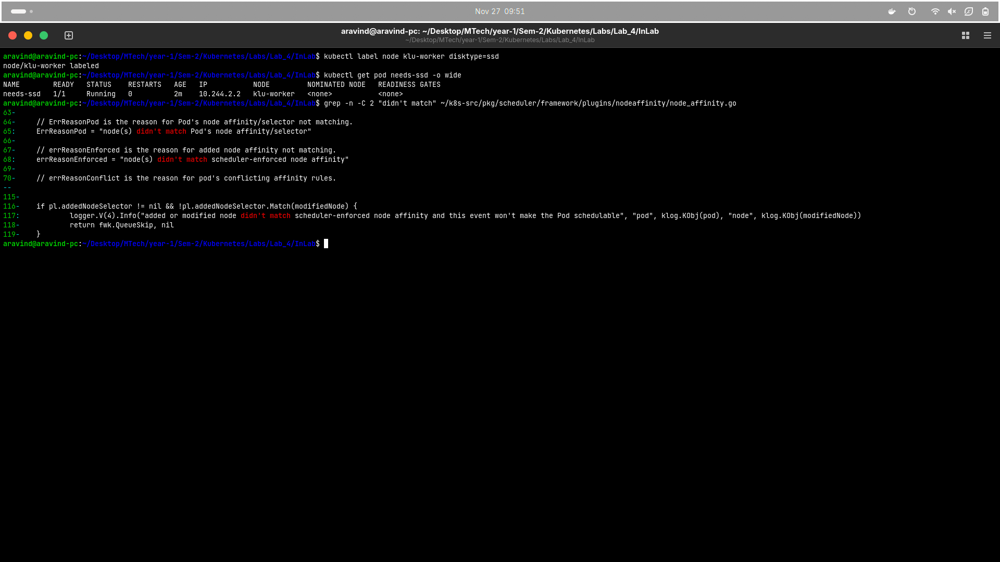

# Lab 4: Read the Scheduler and Find Why Pods Stay Pending

## InLab

### Question 1: Inspect `kube-scheduler` source code (`v1.37.0`), list default filter and score plugins with weights, and trace the scheduling cycle.

#### Step 1: Cluster & Environment Verification
- **Why and what we are doing:** Verify that the 3-node kind cluster (`kind-klu`) is running with all nodes `Ready`, inspect the control-plane taint (`node-role.kubernetes.io/control-plane:NoSchedule`), and confirm Git is installed for sparse cloning.
```bash
kind get clusters
kubectl config use-context kind-klu
kubectl get nodes -o wide
kubectl describe node klu-control-plane | grep Taints
git --version
tree -L 3
```


#### Step 2: Sparse-Clone Kubernetes Scheduler Source (`v1.37.0`)
- **Why and what we are doing:** Download only `pkg/scheduler` and `staging/src/k8s.io/kube-scheduler` from the upstream Kubernetes `v1.37.0` repository using Git sparse checkout to avoid downloading the entire monorepo.
```bash
git clone --depth 1 --branch v1.37.0 --filter=blob:none --sparse https://github.com/kubernetes/kubernetes.git k8s-src
cd ~/k8s-src
git sparse-checkout set pkg/scheduler staging/src/k8s.io/kube-scheduler
ls pkg/scheduler
```


#### Step 3: Identify Default Scheduler Plugins and Weights
- **Why and what we are doing:** Inspect `default_plugins.go` to see all enabled default plugins and their scoring weights (e.g., `TaintToleration` weight `3`, `NodeAffinity` weight `2`, `PodTopologySpread` weight `2`, `InterPodAffinity` weight `2`, `NodeResourcesFit` weight `1`, `NodeResourcesBalancedAllocation` weight `1`, `ImageLocality` weight `1`).
```bash
grep -n 'Name: names' pkg/scheduler/apis/config/v1/default_plugins.go
```


#### Step 4: Locate `Filter` and `Score` Plugin Implementations
- **Why and what we are doing:** Search across `pkg/scheduler/framework/plugins` to find the exact Go files and line numbers implementing the `Filter` and `Score` extension points.
```bash
grep -RnE '^func \(.*\) (Filter|Score)\(' pkg/scheduler/framework/plugins --include='*.go' | grep -v '_test.go'
```


#### Step 5: Trace the Scheduling Cycle (`schedule_one.go`)
- **Why and what we are doing:** Locate the core scheduling functions (`ScheduleOne`, `schedulingCycle`, `bindingCycle`, `schedulePod`, `findNodesThatFitPod`, and `prioritizeNodes`) in `pkg/scheduler/schedule_one.go` to observe how filtering, scoring, and binding execute.
```bash
grep -nE '^func .*?(ScheduleOne|schedulingCycle|bindingCycle|schedulePod|findNodesThatFitPod|prioritizeNodes)\(' pkg/scheduler/schedule_one.go
```


---

### Question 2: Induce `Pending` Pods across controlled experiments and match `FailedScheduling` events to their scheduler filter plugins.

#### Step 1: Experiment A – Insufficient CPU (`NodeResourcesFit` & `TaintToleration`)
- **Why and what we are doing:** Apply [`InLab/big.yaml`](InLab/big.yaml) requesting `cpu: "64"`, observe the `Pending` status and `FailedScheduling` event (`1 node(s) had untolerated taint(s), 2 Insufficient cpu`), and locate the `"Insufficient cpu"` reason inside `noderesources/fit.go`.
```yaml
# InLab/big.yaml
apiVersion: v1
kind: Pod
metadata:
  name: big
spec:
  containers:
    - name: app
      image: nginx:1.27
      resources:
        requests:
          cpu: "64"
```
```bash
kubectl apply -f big.yaml
kubectl describe pod big
grep -n -C 2 'Insufficient' ~/k8s-src/pkg/scheduler/framework/plugins/noderesources/fit.go
```


#### Step 2: Experiment B (Part 1) – Unmatched Node Selector (`NodeAffinity`)
- **Why and what we are doing:** Apply [`InLab/ssd.yaml`](InLab/ssd.yaml) requiring `nodeSelector: disktype: ssd` when no node carries that label, and verify the Pod stays `Pending` because `NodeAffinity` rejects both worker nodes.
```yaml
# InLab/ssd.yaml
apiVersion: v1
kind: Pod
metadata:
  name: needs-ssd
spec:
  nodeSelector:
    disktype: ssd
  containers:
    - name: app
      image: nginx:1.27
```
```bash
kubectl apply -f ssd.yaml
kubectl get pod needs-ssd
kubectl describe pod needs-ssd
```


#### Step 3: Experiment B (Part 2) – Label Node and Verify Automatic Scheduling
- **Why and what we are doing:** Label `klu-worker` with `disktype=ssd`, verify `needs-ssd` automatically transitions to `Running` on `klu-worker`, and locate `ErrReasonPod` in `node_affinity.go`.
```bash
kubectl label node klu-worker disktype=ssd
kubectl get pod needs-ssd -o wide
grep -n -C 2 "didn't match" ~/k8s-src/pkg/scheduler/framework/plugins/nodeaffinity/node_affinity.go
```


#### Step 4: Experiment C (Part 1) – Taint Blocks Worker Node (`TaintToleration`)
- **Why and what we are doing:** Taint `klu-worker` with `exam=running:NoSchedule`, create a 4-replica Deployment `spread`, and verify all 4 Pods are scheduled exclusively onto `klu-worker2`.
```bash
kubectl taint node klu-worker exam=running:NoSchedule
kubectl create deployment spread --image=nginx:1.27 --replicas=4
kubectl get pods -l app=spread -o wide
```


#### Step 5: Experiment C (Part 2) – Add Toleration and Verify Pod Distribution
- **Why and what we are doing:** Apply [`InLab/spread-tol.yaml`](InLab/spread-tol.yaml) adding a matching toleration for `exam=running:NoSchedule` and observe the new Pods spread evenly across both `klu-worker` and `klu-worker2`.
```yaml
# InLab/spread-tol.yaml
apiVersion: apps/v1
kind: Deployment
metadata:
  name: spread
spec:
  replicas: 4
  selector:
    matchLabels:
      app: spread
  template:
    metadata:
      labels:
        app: spread
    spec:
      tolerations:
        - key: exam
          operator: Equal
          value: running
          effect: NoSchedule
      containers:
        - name: nginx
          image: nginx:1.27
```
```bash
kubectl apply -f spread-tol.yaml
kubectl get pods -l app=spread -o wide
```


#### Step 6: Experiment D (Part 1) – HostPort Conflict (`NodePorts`)
- **Why and what we are doing:** Remove the taint on `klu-worker` and apply [`InLab/hostport.yaml`](InLab/hostport.yaml) requesting 3 replicas each binding `hostPort: 8080`. With only 2 worker nodes, 2 Pods run while the 3rd remains `Pending`.
```yaml
# InLab/hostport.yaml
apiVersion: apps/v1
kind: Deployment
metadata:
  name: hostport
spec:
  replicas: 3
  selector:
    matchLabels:
      app: hostport
  template:
    metadata:
      labels:
        app: hostport
    spec:
      containers:
        - name: app
          image: nginx:1.27
          ports:
            - containerPort: 80
              hostPort: 8080
```
```bash
kubectl taint node klu-worker exam=running:NoSchedule-
kubectl apply -f hostport.yaml
kubectl get pods -l app=hostport -o wide
```


#### Step 7: Experiment D (Part 2) – Inspect HostPort Event and Plugin Source
- **Why and what we are doing:** Describe the pending `hostport` Pod to observe `"didn't have free ports for the requested pod ports"` and locate `ErrReason` inside `node_ports.go`.
```bash
kubectl describe pod hostport-7685945bf-k6dsv
grep -n -C 2 'free ports' ~/k8s-src/pkg/scheduler/framework/plugins/nodeports/node_ports.go
```


#### Step 8: Experiment E (Part 1) – Cordon Worker Nodes (`NodeUnschedulable`)
- **Why and what we are doing:** Cordon both `klu-worker` and `klu-worker2` (`SchedulingDisabled`), create a new Pod `closed`, and verify it remains `Pending` with `2 node(s) were unschedulable`.
```bash
kubectl cordon klu-worker
kubectl cordon klu-worker2
kubectl get nodes
kubectl run closed --image=nginx:1.27
kubectl get pod closed
kubectl describe pod closed
```


#### Step 9: Experiment E (Part 2) – Uncordon Nodes and Verify Recovery
- **Why and what we are doing:** Uncordon both worker nodes to re-enable scheduling and confirm the `closed` Pod automatically transitions to `Running` on `klu-worker`.
```bash
kubectl uncordon klu-worker
kubectl uncordon klu-worker2
kubectl get pod closed -o wide
kubectl get nodes
```


---

### Summary: Filter Plugins & `FailedScheduling` Evidence

| Experiment | Rejection Message | Scheduler Plugin | Source File |
| :--- | :--- | :--- | :--- |
| **A** | `Insufficient cpu` | `NodeResourcesFit` | `pkg/scheduler/framework/plugins/noderesources/fit.go` |
| **A–E** | `had untolerated taint(s)` | `TaintToleration` | `pkg/scheduler/framework/plugins/tainttoleration/taint_toleration.go` |
| **B** | `didn't match Pod's node affinity/selector` | `NodeAffinity` | `pkg/scheduler/framework/plugins/nodeaffinity/node_affinity.go` |
| **C** | Taint `exam=running:NoSchedule` / Toleration | `TaintToleration` | `pkg/scheduler/framework/plugins/tainttoleration/taint_toleration.go` |
| **D** | `didn't have free ports for the requested pod ports` | `NodePorts` | `pkg/scheduler/framework/plugins/nodeports/node_ports.go` |
| **E** | `node(s) were unschedulable` | `NodeUnschedulable` | `pkg/scheduler/framework/plugins/nodeunschedulable/node_unschedulable.go` |

---

## PostLab

### Status: Pending / To Be Assigned
- **Directory Status:** The `PostLab/` directory is currently empty.
- **Pending Tasks:** Post-lab exercises and verification outputs will be added to `PostLab/` upon completion.
