# Lab 4: Read the Scheduler and Find Why Pods Stay Pending

## InLab

### Question 1: Inspect `kube-scheduler` source code (`v1.37.0`), list default filter and score plugins with weights, and trace the scheduling cycle.

#### Step 1: Cluster & Environment Verification
- **Why and what we are doing:** Before diving into the scheduler code, I wanted to make sure my 3-node `klu` cluster was healthy and check what taints were already sitting on the control-plane node. Sure enough, `klu-control-plane` has `node-role.kubernetes.io/control-plane:NoSchedule` by default—which explains why normal Pods never land there.
```bash
kind get clusters
kubectl config use-context kind-klu
kubectl get nodes -o wide
kubectl describe node klu-control-plane | grep Taints
git --version
tree -L 3
```
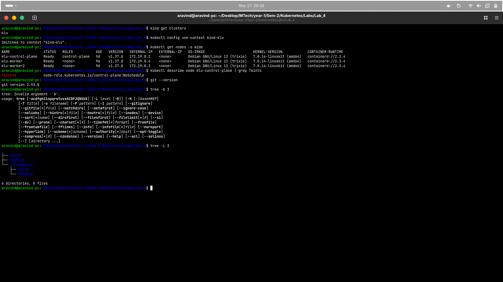

#### Step 2: Sparse-Clone Kubernetes Scheduler Source (`v1.37.0`)
- **Why and what we are doing:** The full Kubernetes repo is huge, and I didn't want to download gigabytes of unrelated code just to read the scheduler. Using Git's `--sparse` checkout on tag `v1.37.0`, I pulled down only `pkg/scheduler` and `staging/src/k8s.io/kube-scheduler` in a few seconds.
```bash
git clone --depth 1 --branch v1.37.0 --filter=blob:none --sparse https://github.com/kubernetes/kubernetes.git k8s-src
cd ~/k8s-src
git sparse-checkout set pkg/scheduler staging/src/k8s.io/kube-scheduler
ls pkg/scheduler
```
*Command breakdown:*
- `--depth 1 --branch v1.37.0` — grab only the latest snapshot of `v1.37.0`, skipping commit history.
- `--filter=blob:none --sparse` — skip downloading file contents until `git sparse-checkout set` specifies the folders we want.
- `git sparse-checkout set ...` — download only the scheduler packages instead of the entire Kubernetes monorepo.
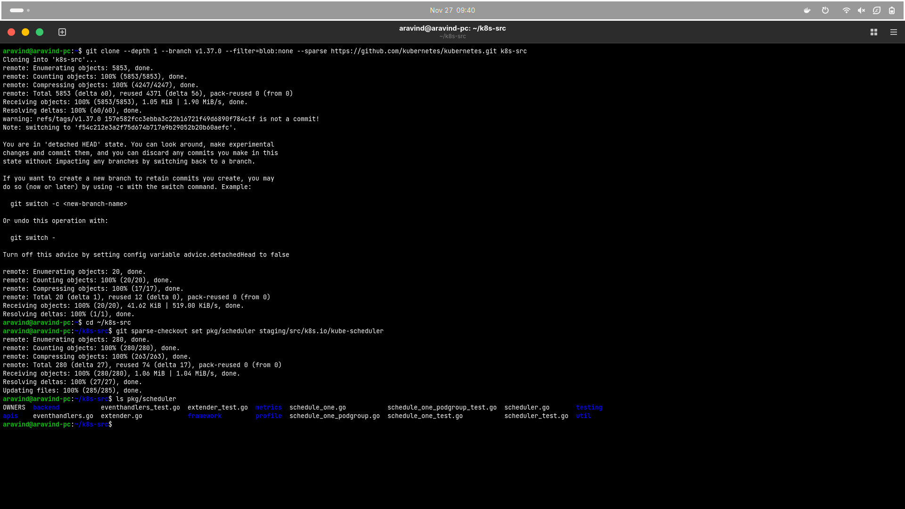

#### Step 3: Identify Default Scheduler Plugins and Weights
- **Why and what we are doing:** I'd heard in class that the scheduler runs plugins with different weights, so I opened `default_plugins.go` to see the actual numbers. It was eye-opening to see `TaintToleration` has weight `3`, `NodeAffinity` and `PodTopologySpread` have `2`, while `NodeResourcesFit` only has `1`.
```bash
grep -n 'Name: names' pkg/scheduler/apis/config/v1/default_plugins.go
```
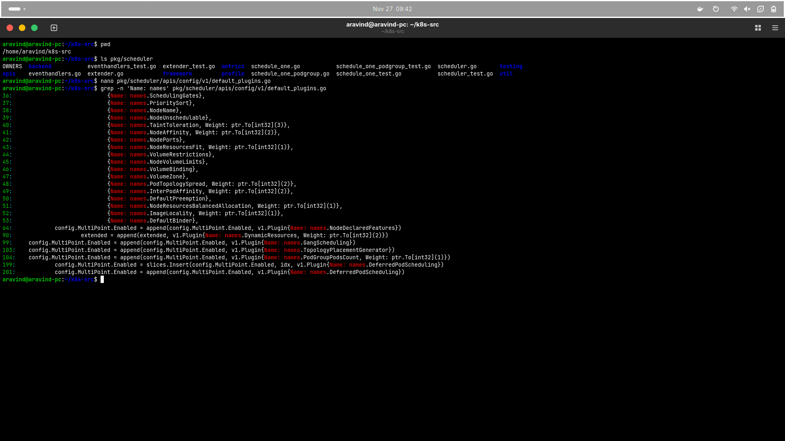

#### Step 4: Locate `Filter` and `Score` Plugin Implementations
- **Why and what we are doing:** Next, I wanted to see where each plugin actually lives in Go. A quick `grep` across `pkg/scheduler/framework/plugins` mapped every `Filter` and `Score` method straight to its `.go` file and line number.
```bash
grep -RnE '^func \(.*\) (Filter|Score)\(' pkg/scheduler/framework/plugins --include='*.go' | grep -v '_test.go'
```
*Command breakdown:*
- `-RnE` — search recursively (`R`), print line numbers (`n`), and use extended regex (`E`).
- `'^func \(.*\) (Filter|Score)\('` — match Go methods named `Filter(` or `Score(`.
- `--include='*.go' | grep -v '_test.go'` — search only Go source files and exclude test files.
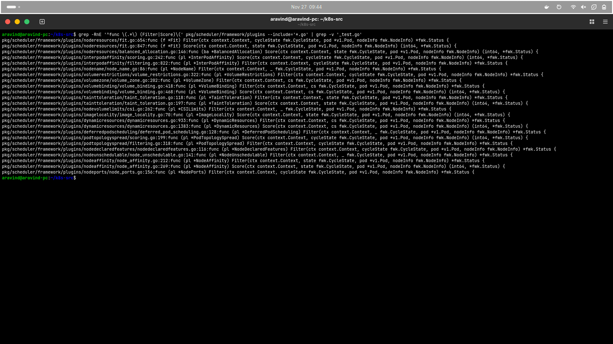

#### Step 5: Trace the Scheduling Cycle (`schedule_one.go`)
- **Why and what we are doing:** Before breaking scheduling on purpose, I looked at `schedule_one.go` to see the exact flow: `ScheduleOne` calls `schedulingCycle` (which runs `findNodesThatFitPod` to filter and `prioritizeNodes` to score), and then `bindingCycle` assigns the Pod to the winning node.
```bash
grep -nE '^func .*?(ScheduleOne|schedulingCycle|bindingCycle|schedulePod|findNodesThatFitPod|prioritizeNodes)\(' pkg/scheduler/schedule_one.go
```


---

### Question 2: Induce `Pending` Pods across controlled experiments and match `FailedScheduling` events to their scheduler filter plugins.

#### Step 1: Experiment A – Insufficient CPU (`NodeResourcesFit` & `TaintToleration`)
- **Why and what we are doing:** To see `NodeResourcesFit` reject a Pod in real life, I asked for `64` CPUs in `big.yaml`—way more than my laptop's kind nodes have. When I ran `kubectl describe pod big`, the event told the exact story of all 3 nodes: `1 node(s) had untolerated taint(s)` (the control plane) and `2 Insufficient cpu` (the two workers). Grepping `fit.go` showed the exact line returning `"Insufficient cpu"`.
```yaml
apiVersion: v1
kind: Pod
metadata:
  name: big
spec:
  containers:
    - name: app
      image: nginx:1.27
      resources:
        requests:
          cpu: "64"
```
```bash
kubectl apply -f big.yaml
kubectl describe pod big
grep -n -C 2 'Insufficient' ~/k8s-src/pkg/scheduler/framework/plugins/noderesources/fit.go
```


#### Step 2: Experiment B (Part 1) – Unmatched Node Selector (`NodeAffinity`)
- **Why and what we are doing:** Next, I created a Pod (`needs-ssd`) asking for `disktype: ssd` via `nodeSelector`, even though none of my nodes have that label yet. As expected, it stayed `Pending` with `2 node(s) didn't match Pod's node affinity/selector`.
```yaml
apiVersion: v1
kind: Pod
metadata:
  name: needs-ssd
spec:
  nodeSelector:
    disktype: ssd
  containers:
    - name: app
      image: nginx:1.27
```
```bash
kubectl apply -f ssd.yaml
kubectl get pod needs-ssd
kubectl describe pod needs-ssd
```
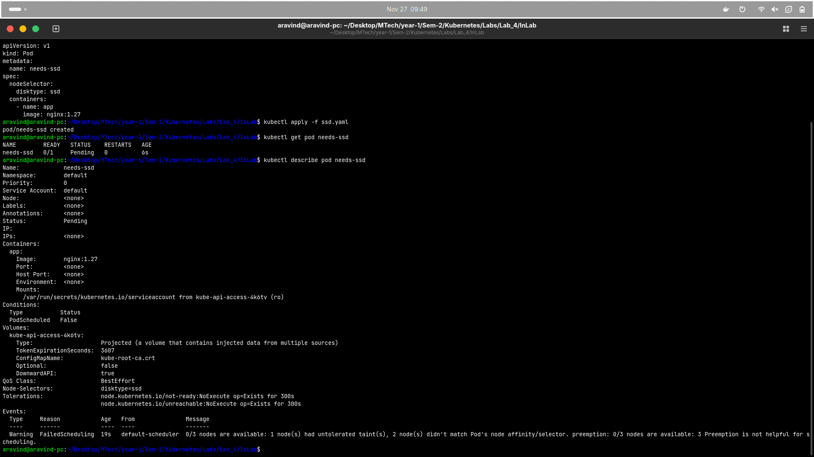

#### Step 3: Experiment B (Part 2) – Label Node and Verify Automatic Scheduling
- **Why and what we are doing:** Without deleting or touching the `Pending` Pod, I added `disktype=ssd` to `klu-worker`. Almost immediately, the scheduler noticed the node update, re-evaluated the Pod, and placed it onto `klu-worker` (`Running`). Checking `node_affinity.go` confirmed the exact `ErrReasonPod` string we saw earlier.
```bash
kubectl label node klu-worker disktype=ssd
kubectl get pod needs-ssd -o wide
grep -n -C 2 "didn't match" ~/k8s-src/pkg/scheduler/framework/plugins/nodeaffinity/node_affinity.go
```


#### Step 4: Experiment C (Part 1) – Taint Blocks Worker Node (`TaintToleration`)
- **Why and what we are doing:** To test taints myself, I put `exam=running:NoSchedule` on `klu-worker` and deployed 4 replicas of nginx. Watching `kubectl get pods -o wide`, all 4 Pods avoided `klu-worker` and piled onto `klu-worker2`.
```bash
kubectl taint node klu-worker exam=running:NoSchedule
kubectl create deployment spread --image=nginx:1.27 --replicas=4
kubectl get pods -l app=spread -o wide
```
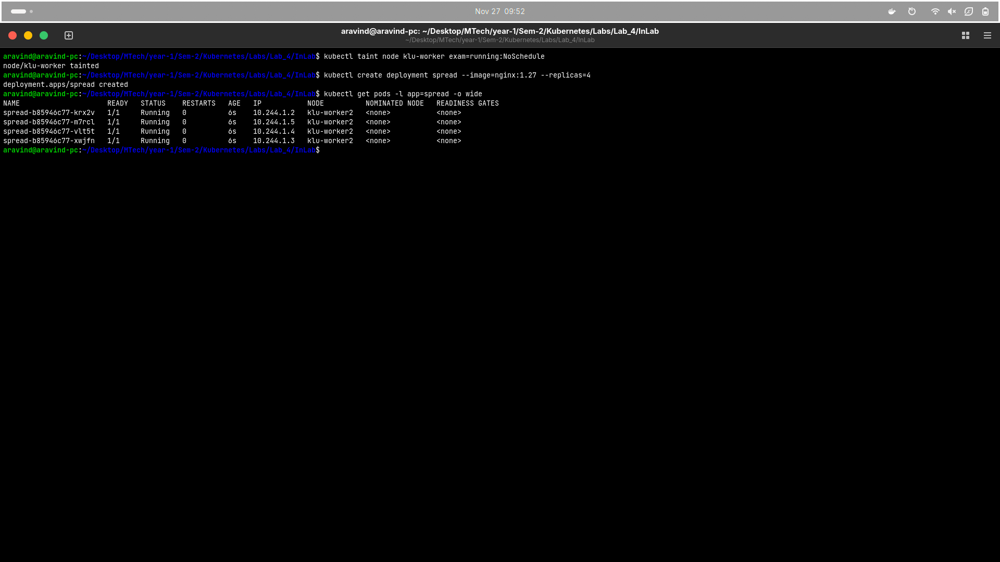

#### Step 5: Experiment C (Part 2) – Add Toleration and Verify Pod Distribution
- **Why and what we are doing:** Then I gave the Deployment a matching toleration (`exam=running:NoSchedule`) in `spread-tol.yaml` and applied it. Once the new Pods had a "pass" to ignore the taint, the scheduler balanced them evenly: 2 on `klu-worker` and 2 on `klu-worker2`.
```yaml
apiVersion: apps/v1
kind: Deployment
metadata:
  name: spread
spec:
  replicas: 4
  selector:
    matchLabels:
      app: spread
  template:
    metadata:
      labels:
        app: spread
    spec:
      tolerations:
        - key: exam
          operator: Equal
          value: running
          effect: NoSchedule
      containers:
        - name: nginx
          image: nginx:1.27
```
```bash
kubectl apply -f spread-tol.yaml
kubectl get pods -l app=spread -o wide
```
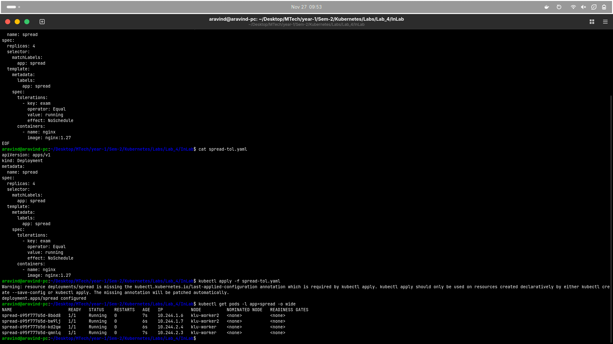

#### Step 6: Experiment D (Part 1) – HostPort Conflict (`NodePorts`)
- **Why and what we are doing:** I removed the taint from `klu-worker` and tried something different: a 3-replica Deployment where every Pod claims `hostPort: 8080`. Since only one Pod per node can bind port 8080 on the host and I only have 2 workers, 2 Pods started running and the 3rd got stuck `Pending`.
```yaml
apiVersion: apps/v1
kind: Deployment
metadata:
  name: hostport
spec:
  replicas: 3
  selector:
    matchLabels:
      app: hostport
  template:
    metadata:
      labels:
        app: hostport
    spec:
      containers:
        - name: app
          image: nginx:1.27
          ports:
            - containerPort: 80
              hostPort: 8080
```
```bash
kubectl taint node klu-worker exam=running:NoSchedule-
kubectl apply -f hostport.yaml
kubectl get pods -l app=hostport -o wide
```
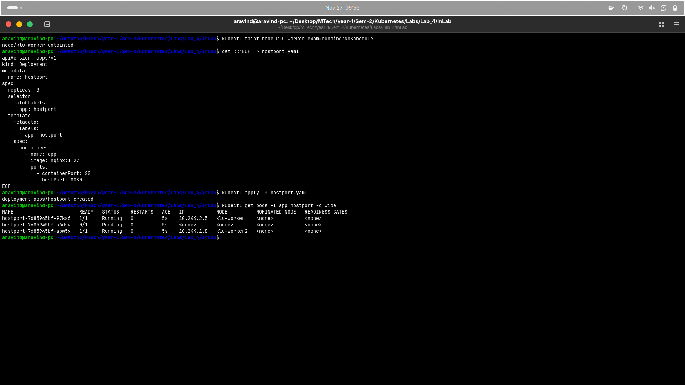

#### Step 7: Experiment D (Part 2) – Inspect HostPort Event and Plugin Source
- **Why and what we are doing:** Describing the stuck 3rd Pod showed `2 node(s) didn't have free ports for the requested pod ports`, which matched `ErrReason` in `node_ports.go` word for word.
```bash
kubectl describe pod hostport-7685945bf-k6dsv
grep -n -C 2 'free ports' ~/k8s-src/pkg/scheduler/framework/plugins/nodeports/node_ports.go
```
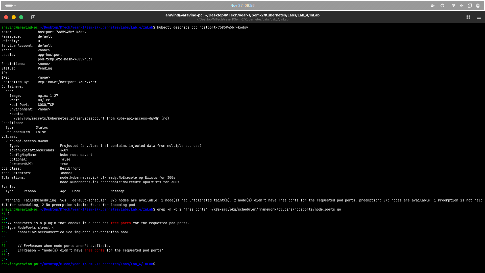

#### Step 8: Experiment E (Part 1) – Cordon Worker Nodes (`NodeUnschedulable`)
- **Why and what we are doing:** Finally, I cordoned both workers (`kubectl cordon`) to see how maintenance mode behaves. Existing Pods kept running untouched, `kubectl get nodes` showed `Ready,SchedulingDisabled`, and a new Pod named `closed` stayed `Pending` with `2 node(s) were unschedulable`.
```bash
kubectl cordon klu-worker
kubectl cordon klu-worker2
kubectl get nodes
kubectl run closed --image=nginx:1.27
kubectl get pod closed
kubectl describe pod closed
```
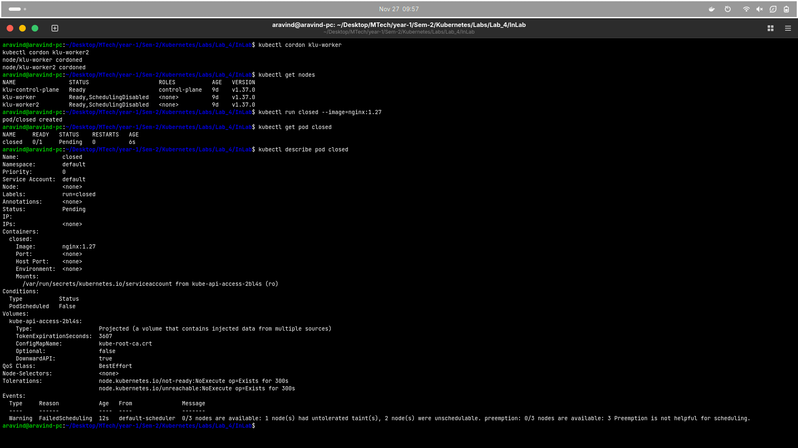

#### Step 9: Experiment E (Part 2) – Uncordon Nodes and Verify Recovery
- **Why and what we are doing:** As soon as I uncordoned both workers, the scheduler woke up and placed `closed` onto `klu-worker`. Seeing the cluster recover on its own made the difference between "cordoned" (`NodeUnschedulable`) and "full" (`NodeResourcesFit`) click immediately.
```bash
kubectl uncordon klu-worker
kubectl uncordon klu-worker2
kubectl get pod closed -o wide
kubectl get nodes
```
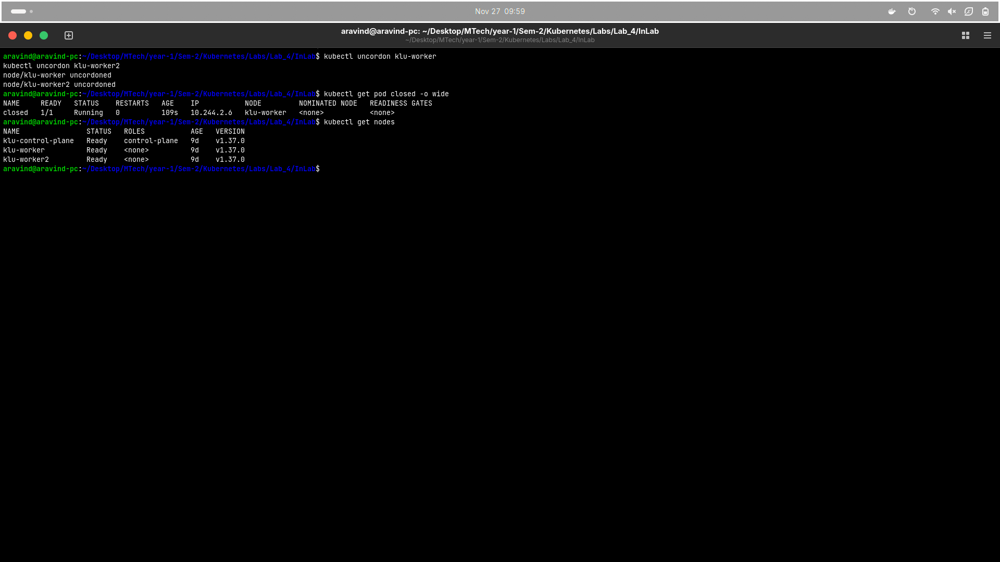

---

### Summary: Filter Plugins & `FailedScheduling` Evidence

| Experiment | Rejection Message | Scheduler Plugin | Source File |
| :--- | :--- | :--- | :--- |
| **A** | `Insufficient cpu` | `NodeResourcesFit` | `pkg/scheduler/framework/plugins/noderesources/fit.go` |
| **A–E** | `had untolerated taint(s)` | `TaintToleration` | `pkg/scheduler/framework/plugins/tainttoleration/taint_toleration.go` |
| **B** | `didn't match Pod's node affinity/selector` | `NodeAffinity` | `pkg/scheduler/framework/plugins/nodeaffinity/node_affinity.go` |
| **C** | Taint `exam=running:NoSchedule` / Toleration | `TaintToleration` | `pkg/scheduler/framework/plugins/tainttoleration/taint_toleration.go` |
| **D** | `didn't have free ports for the requested pod ports` | `NodePorts` | `pkg/scheduler/framework/plugins/nodeports/node_ports.go` |
| **E** | `node(s) were unschedulable` | `NodeUnschedulable` | `pkg/scheduler/framework/plugins/nodeunschedulable/node_unschedulable.go` |

---

## PostLab

### Status: Pending / To Be Assigned
- **Directory Status:** The `PostLab/` directory is currently empty.
- **Pending Tasks:** Post-lab exercises and verification outputs will be added to `PostLab/` upon completion.
